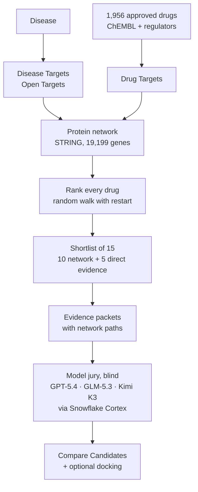
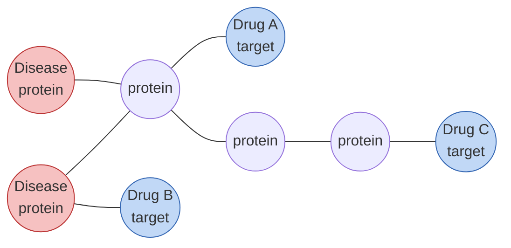

# HalfLife

**A second life for existing medicines.**

Pick a disease. HalfLife finds approved drugs that might help, shows why, and lets three AI models argue over the evidence.

**Live demo:** https://oxhack-workstream-c-x55r7x9w6gv4hp9gw-5173.app.github.dev/

The ranking comes from biomedical data and graph algorithms, not from an AI model. The AI only reviews the shortlist.

## How it works



1. **Targets.** Open Targets gives the proteins linked to the disease. ChEMBL gives each drug's proteins.
2. **Network.** We place both on a map of human protein interactions (STRING 12.5).
3. **Ranking.** A random walk from the disease's proteins scores how strongly each drug's proteins are reached.
4. **Shortlist.** The top 10 by network plus the top 5 by direct evidence make 15 Candidates.
5. **Explanation.** Each Candidate shows the protein paths that link it to the disease.
6. **Model jury.** Three AI models (GPT-5.4, GLM-5.3 and Kimi K3, via Snowflake Cortex) review the same cited evidence without seeing the scores. Every claim must cite real evidence.
7. **Docking (on request).** For a chosen drug and protein with a known 3D structure, AutoDock Vina predicts how the drug might sit in the protein. It shows a possible fit, not that the drug works, and it doesn't change the ranking.

## The ranking engine: random walk with restart

Picture a walker on the protein network. It starts on the disease's proteins and keeps stepping to random neighbours. At every step it has a 30% chance of jumping back to a disease protein. After many steps, proteins near the disease get visited often; distant ones rarely.

A drug scores high when its target proteins get visited a lot.



Drug B's target is one step from a disease protein, so it's visited most. Drug A is close behind. Drug C is far away and scores lowest.

Unlike a single shortest path, the walk counts every route between a drug and the disease.

**More detail:** the maths, settings and test results are in [`ranking/RWR.md`](ranking/RWR.md).

**The shortlist.** The top 10 drugs by walk score, plus the top 5 by direct evidence (their targets are themselves disease proteins), make 15. Shortest paths from each drug's targets to the disease's proteins are saved as the explanation.

**The jury's checks.** Each reply must be valid JSON, rank every Candidate once, cite only real evidence IDs, and quote numbers exactly as the evidence states them. Failed or refused replies are recorded, never filled in. Votes are combined by Borda count over the valid jurors (at least two).

## Results

To check the method works, we hide what we already know. For each disease, we take drugs that regulators have already approved for it, and see whether our method ranks them near the top without being told. Rules, seeds and inputs were frozen before each test ran. Full protocols are in [`results/`](results/).

### 1. Network shortlist (14 diseases)

Each method picks 15 of 1,956 drugs per disease. We count how many drugs already approved for that disease made the 15 (293 possible). Higher is better.

| | Random choice | Z-score | Random walk |
|---|---:|---:|---:|
| Approved drugs found | about 2 | 11 | **15** |
| Recall (macro) | 0.8% | 5.1% | **6.9%** |

**Conclusion:** both methods find 5–7 times more approved drugs than random choice, so the protein network carries real signal. Random walk did slightly better than z-score, but on 14 diseases that gap could be luck.

### 2. Model jury (14 new diseases, drug names hidden, pre-registered)

Each panel has 15 drugs: 1 already approved for the disease and 14 that aren't. The model ranks them without seeing drug names. Hits@5 counts how often the approved drug lands in the top 5 (chance 33%); MRR rewards ranking it higher (chance 0.22, perfect 1.0).

Higher Hits@5 and MRR are better. The p-value says how likely a score this high would be by luck alone, corrected for testing several methods; below 0.05 counts as beating chance.

| Method | Hits@5 | MRR | Beats chance? (p) |
|---|---:|---:|---|
| GPT-5.4 alone | 8 / 14 | **0.461** | **Yes** (0.013) |
| Claude Opus 5.5 alone | 6 / 14 | **0.422** | **Yes** (0.049) |
| Kimi K3 alone | 7 / 14 | 0.374 | No (0.19) |
| Three-model jury | 4 / 14 | 0.210 | No |
| Direct-evidence ranking | 0 / 14 | 0.111 | No |
| Network z-score | 3 / 14 | 0.182 | No |

The jury lost because Opus's safety filter refused about half its calls, and a jury then only counted with all three votes. We changed the rule to use every valid juror (at least two) and replaced Opus with GLM-5.3. The new jury (GPT-5.4, GLM-5.3, Kimi K3) was chosen on separate pilot diseases and hasn't been through a full blind test yet.

With drug names shown, models score much higher (MRR about 0.5–0.6 in our pilot) because they recognise the drugs. That's why the tests hide names.

### Coverage

- 1,307 of 1,956 drugs (66.8%) can be scored on the protein network.
- The rest: 557 have no known targets, 16 have targets not in the network, and 76 have targets outside its largest connected part. They get no network score (never zero), but can still enter through direct evidence.

### Limits

- This tests recovery of known approvals, not whether a drug works.
- One frozen case used a symptom-measurement ID for multiple sclerosis; dropping it changes no conclusion ([`results/ERRATA.md`](results/ERRATA.md)).

These are research leads, not treatment advice.

## Data

| Source | Used for |
|---|---|
| [Open Targets](https://platform.opentargets.org/) 26.09 | Disease–protein links |
| [ChEMBL](https://www.ebi.ac.uk/chembl/) 37 | Drugs and their proteins |
| [STRING](https://string-db.org/) 12.5 | Protein interactions |
| [Reactome](https://reactome.org/) | Pathways |
| [RCSB PDB](https://www.rcsb.org/) | Protein structures for docking |
| FDA, EMA, PMDA, DailyMed | Approvals and safety warnings |

Large downloads stay out of Git. Each source keeps its own licence.

## Repository

```text
pipeline/      Data: diseases, drugs, protein mapping, evidence packets
ranking/       Network, scoring, shortlist, evaluation
workstream_b/  App-facing shortlist and paths
jury/          Model jury client and checks
fixtures/      Sample data formats
results/       Experiments, protocols, errata
plan.md        Project specification
```

## Run the tests

```bash
uv sync
uv run pytest                                   # pipeline and jury
python -m pip install -e ./ranking
python -m unittest discover -s ranking/tests    # network ranking
```

The jury has a mock mode, so no Snowflake account is needed for tests. Building real rankings needs the source data; see [`ranking/README.md`](ranking/README.md).

## Team

Built at OxHack '26.

- **Jessica:** data pipeline, evidence, Model jury, experiments.
- **Zaid:** protein network, ranking algorithms, shortlist, evaluation.
- **Abudi:** app, backend, docking, deployment.
