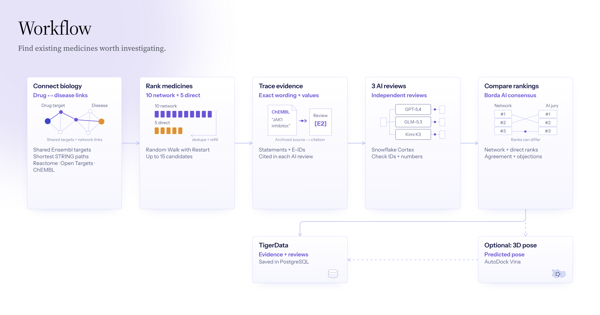
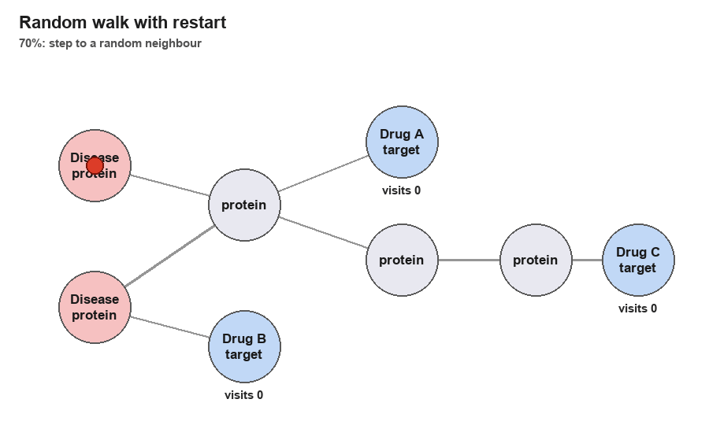
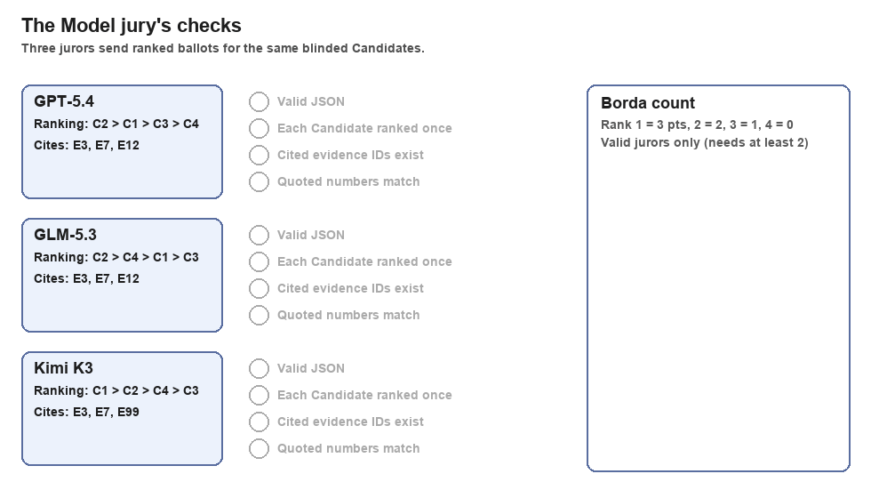

# Half Life

> **Network-based drug repurposing: random walk with restart over the STRING protein
> interactome shortlists approved drugs for a chosen disease, and a citation-checked LLM jury
> on Snowflake Cortex reviews the evidence blind.**

🏆 **Winner of MLH's Best Use of Snowflake API at OxHack '26**

[](https://halflife-bio.vercel.app/)
[](https://devpost.com/software/we-ll-figure-out)
[](https://oxhack-2026.devpost.com/project-gallery)

[](https://www.python.org/)
[](https://fastapi.tiangolo.com/)
[](https://react.dev/)
[](https://www.typescriptlang.org/)
[](https://vite.dev/)
[](https://www.tigerdata.com/)
[](https://docs.snowflake.com/en/user-guide/snowflake-cortex/llm-functions)
[](https://vina.scripps.edu/)
[](https://www.rdkit.org/)
[](https://3dmol.csb.pitt.edu/)
[](https://vercel.com/)

[](https://platform.opentargets.org/)
[](https://www.ebi.ac.uk/chembl/)
[](https://string-db.org/)
[](https://reactome.org/)
[](https://www.rcsb.org/)

## 👥 Team

| Member | Worked on |
|---|---|
| **Jessica Mak** · [@Jessica-mak](https://github.com/Jessica-mak) | Data pipeline, evidence, Model jury, experiments |
| **Zaid Ghodiwala** · [@ZaidGhodiwala](https://github.com/ZaidGhodiwala) | Protein network, ranking algorithms, shortlist, evaluation |
| **Abdullah Alshamam** · [@Abudidayo](https://github.com/Abudidayo) | App, backend, docking, deployment |

## 📑 Contents

- [How it works](#-how-it-works)
- [The ranking engine](#-the-ranking-engine-random-walk-with-restart)
- [The Model jury on Snowflake Cortex](#-the-model-jury-on-snowflake-cortex)
- [Results](#-results)
- [Data](#-data)
- [Run it](#-run-it)
- [Repository map](#-repository-map)

## 🔬 How it works



The ranking comes from biomedical data and graph algorithms, not from an AI model. The AI
only reviews the shortlist.

1. **Connect.** Open Targets gives the proteins linked to the disease, ChEMBL gives each
   drug's proteins, and both are placed on STRING 12.5's network of human protein
   interactions.
2. **Rank and shortlist.** A random walk scores every drug. The top 10 by network plus the
   top 5 by direct evidence make 15 Candidates, each with the protein paths that link it
   to the disease.
3. **Review.** Three AI models read the same cited evidence, blind to the scores, and vote.
4. **Dock, on request.** For a drug and protein with a known 3D structure, AutoDock Vina
   predicts how the drug might sit in the protein. It shows a possible fit, not that the
   drug works, and it doesn't change the ranking.

## 🧭 The ranking engine: random walk with restart

Picture a walker on the protein network. It starts on the disease's proteins and keeps
stepping to random neighbours. At every step it has a 30% chance of jumping back to a
disease protein. After many steps, proteins near the disease get visited often; distant
ones rarely. A drug scores high when its target proteins get visited a lot.



The red dot is the walker. Glow shows how often each protein is visited. Drug B's target
is one step from a disease protein, so it's visited most; Drug C is far away and scores
lowest. Unlike a single shortest path, the walk counts every route between a drug and the
disease.

The shortest paths from each drug's targets to the disease's proteins are saved as its
explanation. The maths, settings and test results are in
[`docs/ranking/RWR.md`](docs/ranking/RWR.md).

## 🤖 The Model jury on Snowflake Cortex

The jury is three models (GPT-5.4, GLM-5.3 and Kimi K3) running on Snowflake Cortex,
Snowflake's hosted AI service. Each one ranks the shortlist from the same evidence packets, without seeing the
network scores. Every reply is checked before it counts:

- it must be valid JSON and rank every Candidate exactly once;
- it may cite only real evidence IDs;
- it must quote numbers exactly as the evidence states them.

Failed or refused replies are recorded, never filled in. Votes are combined by Borda count
over the valid jurors, and a consensus needs at least two.



## 📊 Results

To check the method works, we hide what we already know. For each disease we take the
drugs regulators have already approved for it and see whether the method ranks them near
the top without being told. Rules, seeds and inputs were frozen before each test ran.
Full protocols are in [`results/`](results/).

<details>
<summary><b>1. Network shortlist</b>: random walk finds 15 of 293 approved drugs across 14 diseases</summary>

<br>

Each method picks 15 of 1,956 drugs per disease. We count how many drugs already approved
for that disease made the 15 (293 possible). Higher is better.

| | Random choice | Z-score | Random walk |
|---|---:|---:|---:|
| Approved drugs found | about 2 | 11 | **15** |
| Recall (macro) | 0.8% | 5.1% | **6.9%** |

Both methods find 5-7 times more approved drugs than random choice, so the protein network
carries real signal. Random walk did slightly better than z-score.

</details>

<details>
<summary><b>2. Model jury</b>: blind test on 14 new diseases, drug names hidden, pre-registered</summary>

<br>

Each panel has 15 drugs: 1 already approved for the disease and 14 that aren't. The model
ranks them without seeing drug names. Hits@5 counts how often the approved drug lands in
the top 5 (chance 33%); MRR rewards ranking it higher (chance 0.22, perfect 1.0). The
p-value is the chance a score this high happens by luck; below 0.05 means it beat chance.

| Method | Hits@5 | MRR | Beats chance? (p) |
|---|---:|---:|---|
| GPT-5.4 alone | 8 / 14 | **0.461** | **Yes** (0.013) |
| Claude Opus 5.5 alone | 6 / 14 | **0.422** | **Yes** (0.049) |
| Kimi K3 alone | 7 / 14 | 0.374 | No (0.19) |
| Three-model jury | 4 / 14 | 0.210 | No |
| Direct-evidence ranking | 0 / 14 | 0.111 | No |
| Network z-score | 3 / 14 | 0.182 | No |

The jury lost because Opus's safety filter refused about half its calls, and a jury then
only counted with all three votes. We changed the rule to use every valid juror (at least
two) and replaced Opus with GLM-5.3. The new jury (GPT-5.4, GLM-5.3, Kimi K3) was chosen
on separate pilot diseases and hasn't been through a full blind test yet.

With drug names shown, models score much higher (MRR about 0.5-0.6 in our pilot) because
they recognise the drugs. That's why the tests hide names.

</details>

<details>
<summary><b>3. Coverage</b>: 1,307 of 1,956 drugs can be scored on the network</summary>

<br>

- 1,307 of 1,956 drugs (66.8%) can be scored on the protein network.
- The rest: 557 have no known targets, 16 have targets not in the network, and 76 have
  targets outside its largest connected part. They get no network score (never zero), but
  can still enter through direct evidence.

</details>

## 🧬 Data

| Source | Used for |
|---|---|
| [Open Targets](https://platform.opentargets.org/) 26.09 | Disease-protein links |
| [ChEMBL](https://www.ebi.ac.uk/chembl/) 37 | Drugs and their proteins |
| [STRING](https://string-db.org/) 12.5 | Protein interactions |
| [Reactome](https://reactome.org/) | Pathways |
| [RCSB PDB](https://www.rcsb.org/) | Protein structures for docking |
| FDA, EMA, PMDA, DailyMed | Approvals and safety warnings |

Large downloads stay out of Git. Each source keeps its own licence.

## 🚀 Run it

Run the app locally on saved sample data, with no accounts or keys:

```bash
uv sync --all-packages
uv run uvicorn oxhack_api.app:app --reload   # API on http://127.0.0.1:8000

cd app/web && npm install && npm run dev      # website, proxies /api to the API
```

Live data, the Snowflake jury and real docking are switched on with `OXHACK_*` settings;
every one is listed in [`.env.example`](.env.example) and [`app/api/README.md`](app/api/README.md).

Run the tests:

```bash
uv run pytest                                          # pipeline and jury
python -m pip install -e ./core/ranking
python -m unittest discover -s core/ranking/tests      # network ranking
cd app/web && npm test && npm run e2e                  # website
```

The jury has a mock mode, so no Snowflake account is needed for tests. Building real
rankings needs the source data; see [`core/ranking/README.md`](core/ranking/README.md).

## 📁 Repository map

```text
app/           The product
  web/           Website and app
  api/           Backend API
  worker/        Docking worker
core/          The science
  pipeline/      Data: diseases, drugs, protein mapping, evidence packets
  jury/          Model jury client and checks
  ranking/       Network, scoring, shortlist, evaluation
deploy/        Running it
  db/            Database migrations
  vercel/        Vercel deployment: function entry, deploy folder, docking snapshot
  serve.sh       Start the API and workers
  redeploy.sh    Run the demo in a Codespace
docs/          Glossary, build reference, ranking method notes, research notes
results/       Sealed experiments, protocols, errata
tests/         Pipeline and jury tests; sample data formats in tests/fixtures/
```
