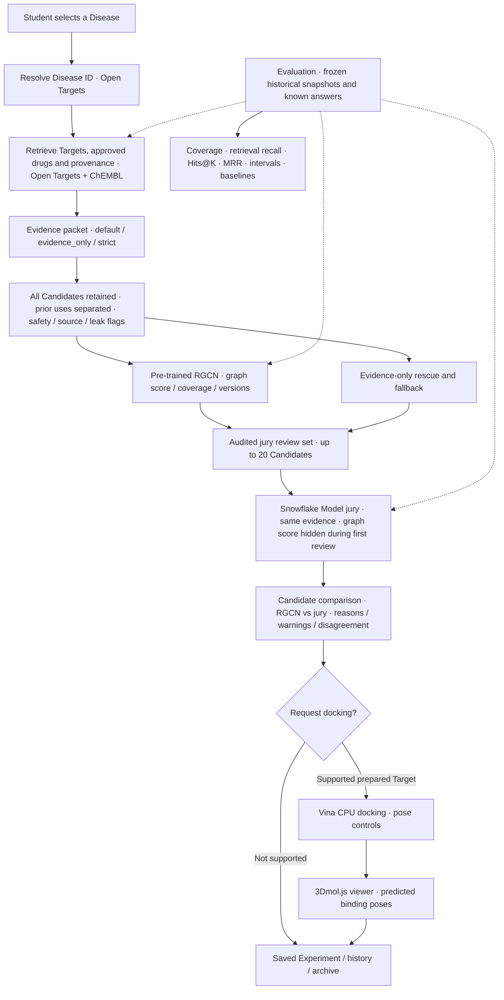
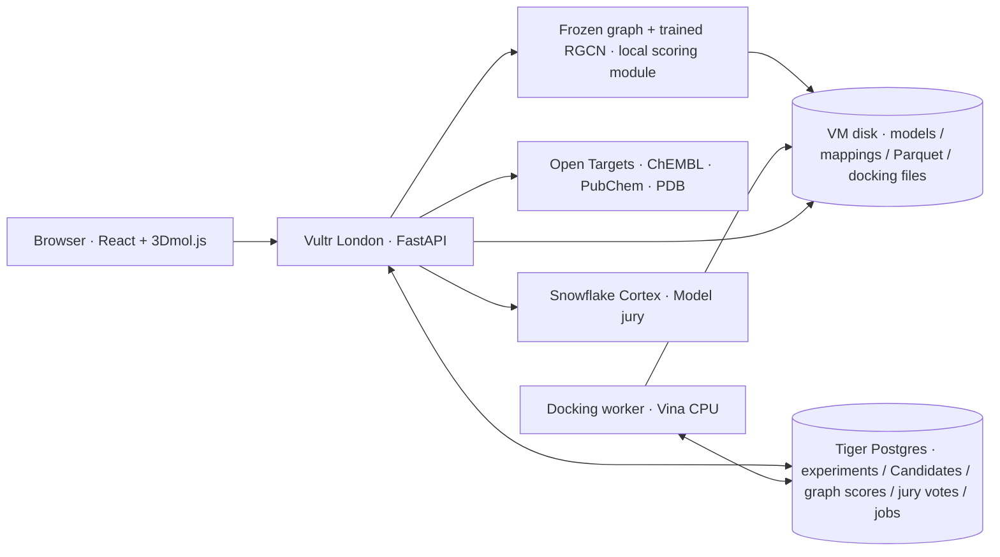

# OxHack '26 build plan

This is the team's **revised, buildable plan** incorporating the agreed **Open Targets / ChEMBL → RGCN → Model jury → docking** pipeline. Read sections 1–4 and agree the shared contracts in section 6 **before** parallel implementation. All scientific caveats and fallbacks are part of the product, not optional fine print.

**Status, 24 Oct 2026:** proposed technical plan, not proof of working services, model weights, API responses, deployment, or benchmark results. Training, model coverage, latency, current endpoint/model availability and hardware must be verified. The pre-existing research is in `reports/OxHack 26 drug repurposing plan.md` and `research_notes/OxHack 26 drug repurposing plan/`; these paths are references, not guaranteed to be present in every checkout. UI terminology follows `CONTEXT.md`.

**What changed from the previous build plan:**

- Moved **RGCN from an optional future benchmark ranker into the intended core Candidate-prioritisation stage**.
- Made the **Model jury a source-grounded second-stage reviewer**, rather than the sole Candidate ranking component.
- Introduced a **15 graph-ranked + 5 evidence-rescue** review set; complete Candidate results stay accessible.
- Added model training/inference artifacts, API contracts, Postgres schema, coverage states, acceptance tests and an evidence-only fallback.
- Redesigned evaluation to separate **historical model evaluation**, **contemporary Known-answer checks**, **retrieval/shortlist recall** and **fixed-panel ranking**, reducing misleading leakage claims.

**One-line architecture:** structured biomedical data proposes eligible Candidates → a pre-trained **RGCN** assigns graph-based priorities where it has coverage → an evidence-grounded **Model jury** critically reviews a transparent shortlist, retaining disagreements and warnings → users compare Candidates and optionally inspect docking poses. **A graph score, jury vote and docking pose are three different forms of evidence; none is a probability of therapeutic success.**

## 1. What we are building

A guided web app primarily for students (researchers are a secondary audience). A student enters any **Disease**, and the app:

1. Resolves it to a stable Open Targets disease ID, retaining the searched and resolved names.
2. Finds its **Targets** and their source-backed associations, displaying three evidence modes: `default`, `evidence_only`, `strict`.
3. Retrieves existing, regulator-approved drugs acting on those Targets via mechanisms and ChEMBL bioactivity. Separates **Already used or trialled for this disease** from **Repurposing candidates**. Retains all supported Candidates and their sources.
4. Assembles a **candidate evidence packet** with target mechanisms, measured activity, approval provenance, safety warnings or `unknown`, and leakage flags. Nothing unverified is silently presented as a fact.
5. Calls the **RGCN graph-ranking service** to score eligible Candidates against the Disease using a **previously prepared/trained knowledge graph**. It returns raw ranking scores, coverage, graph and model versions, and explicit `not_in_graph` statuses. It is not retrained on every search.
6. Forms an auditable **jury review set**: up to 15 supported top RGCN Candidates, plus up to 5 high-evidence Candidates the graph would otherwise miss; use an evidence-only fallback for unsupported diseases or model failure. The graph never permanently hides Candidates.
7. Gives every **Model jury** member the **same evidence packet** for that same review set, asks them to rank and explain, and shows agreement, disagreement, source links and safety uncertainty. **In the first comparison, jury members do not see the RGCN score or order; display that ranking beside their conclusions afterward.**
8. Lets a user choose a Candidate and prepared Target structure to request docking. Visualises predicted **binding poses** in 3D with controls and method provenance, keeping docking scores outside Candidate rankings.
9. Saves the **Experiment** (one Disease, one jury configuration and one ranking configuration), Candidate results, RGCN outputs, jury decisions, docking results and audit metadata. Supports within-experiment **Candidate comparison**, history, archive and restore.

**Why both RGCN and jury?** RGCN learns statistical patterns among known biomedical links. The jury checks the accessible evidence for biological plausibility, mechanism direction, contradictory findings and missing information. The jury can place the RGCN's top suggestion lower. It cannot clinically verify the suggestions.

**Primary product demo:** a real Disease search showing source-backed Candidates, graph coverage/priority, a jury reordering or rejecting some suggestions on evidential grounds, and a live/cached clearly labelled docking result. **Primary research result:** reproducible evaluation of each stage and the combined pipeline against baselines (section 7 and section 8). COVID-19/baricitinib is a **Known-answer check**, not a new discovery; multiple myeloma is another worked example. Never insert a known answer to force success.

**Explicit gate:** RGCN is the intended architecture, but its real training and disease/drug coverage must pass the milestone in section 8. If it does not, the shipped app still supports the agreed evidence → jury → docking journey, and explains that graph ranking was unavailable. Do not claim the full RGCN-enhanced pipeline worked if it did not.

**Prize entries to evaluate against actual event rules:** First Place; Runner Up; [HRT] Best Use of Data for Predictions and Decision Making; MLH Best Use of Snowflake API; MLH Best Use of Tiger Data; MLH Best Use of Vultr. No claim of eligibility without checking official terms.

### Workflow



## 2. Decisions

| Area | Decision |
|---|---|
| Diseases | Any disease. COVID-19 (`MONDO_0100096`) and multiple myeloma (`MONDO_0009693`) are worked examples. |
| Backend | Python 3.11 with FastAPI. A separate docking worker process. |
| Frontend | React, Vite and TypeScript. 3Dmol.js for the 3D viewer. |
| Database | Tiger Cloud Postgres (TimescaleDB), on a trial service in `eu-west-2` (London). |
| RGCN | Offline graph construction/training (KG-Bench-inspired PyTorch Geometric RGCN), then a **read-only local scoring service**. Scores only graph-covered drug–disease pairs; training/graph versions and cutoff recorded. |
| Candidate selection | Graph-prioritised + evidence-rescue review set; retains all Candidates for browsing. Never use raw RGCN scores as treatment probabilities. |
| Model jury | Four models from Snowflake Cortex REST's OpenAI-compatible endpoint, using **the same selected evidence**. Jurors independently rank **without graph scores** before results are compared. |
| Docking | AutoDock Vina 1.2.7 with Meeko and RDKit, on CPU. Prepared structures only. |
| Hosting | One Vultr VM in London runs the API, the worker and the built frontend. |
| GPU | **Not needed for docking/inference.** RGCN training feasibility on CPU must be measured early; GPU availability could accelerate offline training if needed, but is not assumed. Optional GPU docking work is deferred (section 13). |
| Not building | DiffDock, Boltz-2, GNINA, co-folding models, B200/B300 rental, DGX Spark, docking inside Snowflake, training models in a live request, database forks, experiment branching, cross-experiment comparison, new molecules, Gemini, ElevenLabs, Solana, Presage, Delta. |

Abudi's Node test bench (`demos/data-sources/`) stays as a reference for working query text. The production backend is Python for RDKit, Vina, Meeko, pandas, SciPy and PyTorch Geometric.

**Graph-version separation:** the live evidence fetch may use Open Targets `26.09` while the first RGCN was trained on a **historical** graph. This is an intentional difference: do **not** silently merge 26.09 edges into the frozen RGCN or score unseen node identifiers. A later refresh can retrain against a newer graph with its **own** model version, but that newer model **cannot** be evaluated as though it only knew 2021 data.

### Infrastructure



**Deployment rule:** RGCN graph construction and training happen **offline**, not in a student-facing request. The live API loads an immutable model and graph snapshot at startup; it can fail closed to the evidence-only fallback without taking down the rest of the app.

## 3. Ground rules

- **Fresh repo and event eligibility.** The previous plan assumes that reuse of pre-event code affects MLH prize eligibility; **verify the official rules with organisers** rather than treating this assumption as confirmed. `prototypes/` predates the start.
  - Create a new public GitHub repo and make its first commit during the event.
  - Copy across only planning text (`plan.md`, `CONTEXT.md`, `docs/mvp-spec.md`, `docs/team-build-plan.md`) and `demos/data-sources/`, which was written during the event.
  - Do not copy `prototypes/` or the primer; rebuild the UI from scratch.
  - Say on Devpost that planning happened before the event and all code was written during it.
- **Pinned queries.** Open Targets 26.09 renamed its drug fields and kept no deprecated aliases, so older queries fail outright.
  - Use only the queries in section 7.
  - Never let an LLM write GraphQL or SQL at runtime.
- **Secrets** live in `.env`, which is gitignored. Commit `.env.example` with variable names only.
- **Timestamps** are stored as `timestamptz` in UTC.
- **Safety.** A drug with no recorded warnings shows "Safety: unknown", never "safe".
- **Approval.** Call a drug approved only when a regulator report backs it (`FDA`, `EMA Human Drugs`, `PMDA` or `DailyMed`). Open Targets stage fields lag behind regulators.
- **Docking scores** never feed the ranking.
- **Model boundaries.** No raw GraphQL/ChEMBL JSON is fed directly into RGCN. Offline preprocessors build typed graph nodes, relation edges and feature tensors; live scoring maps stable identifiers to that frozen graph.
- **Coverage.** If the Disease or Candidate is missing from RGCN's graph, show `not_in_graph`; **never** invent a graph score or reject the Candidate for that reason.
- **Shortlisting.** RGCN can prioritise which Candidates the jury reviews, but all eligible Candidates remain browseable and the evidence-rescue lane prevents a pure graph-only bottleneck.
- **Jury independence.** Do not show RGCN scores or rank positions to the initial jurors. Keep jury evidence packets identical in content across models and store order seeds; compare graph and jury **after** the initial vote.
- **Scientific evaluation.** A historical held-out test must use graph edges, evidence and approval knowledge from **before** its test cutoff. Merely hiding trial text in a 2026 prompt does not remove future knowledge already present in a graph or model. Report any violations as contaminated, not as retrospective performance.
- **No medical recommendation.** Candidates are hypotheses for research, never treatment guidance; significant warnings remain visible even when the Candidate is deprioritised.

## 4. Roles

| Role | Owns |
|---|---|
| A | **Biomedical evidence / RGCN data owner**: Open Targets, ChEMBL, ID alignment, graph snapshots, leakage-free datasets, backtest and baselines. Owns the model input/data contracts. |
| B | **RGCN model + Model jury owner**: isolate/train/load RGCN, coverage-aware scoring API, Snowflake Cortex jurors, independent evidence review and disagreement metrics. Pairs with A on KG compatibility and historical evaluation. |
| C | Vultr VM, docking worker, prepared structures, redocking controls and 3D viewer; assists B with Linux training runtime if needed. |
| D | Frontend, Tiger schema, experiment persistence, Candidate comparison, research metrics, README and Devpost. |

**Roles are provisional until the team agrees ownership.** The RGCN adapter spans two responsibilities and should have a single named integration owner.

**Do in parallel:** A implements real evidence and prepares the KG; B first runs a **minimal RGCN smoke test** on available graph data and proves one stable-ID pair can be scored, *then* completes the Cortex jury. C tests docking immediately; D agrees section 6 contracts and builds fixtures. Model training and graph preparation are shared cross-workstream integration risks, not something to leave to the end.

## 5. Step 0: setup (everyone, in parallel)

### Repo (D)

1. Create the public repo with this layout:

   ```
   api/
     app/main.py         routes
     app/opentargets.py  pinned GraphQL queries (section 7)
     app/chembl.py       ChEMBL REST calls
     app/pubchem.py      PubChem calls
     app/scoring.py      source evidence scores, rescue baseline and leak flags
     app/rgcn.py         read-only graph scoring; ID coverage; model provenance
     app/shortlist.py    graph + evidence rescue; deterministic review-set contract
     app/jury.py         jury calls, validation and aggregation
     app/db.py           Postgres access
   worker/
     dock.py prepare.py
     structures/         prepared receptors and boxes, one folder per PDB ID
   kg/
     README.md           KG-Bench version, provenance, licence and preprocessing notes
     build_graph.py      offline preparation from pinned release
     train_rgcn.py      isolated RGCN training (no six-model loop)
     verify.py           mapping and leakage / graph coverage checks
     artifacts/         model weights, mappings, graph versions (large files ignored)
   backtest/
     build_set.py run.py metrics.py
     frozen/             manifests, baselines and dated results
   tests/
     test_contracts.py test_rgcn.py test_shortlist.py test_backtest.py
   web/                  React + Vite + TypeScript
   db/schema.sql
   data/                 Parquet cache (gitignored)
   .env.example
   ```

2. Create `.env.example`:

   ```
   DATABASE_URL=
   SNOWFLAKE_ACCOUNT=        # <orgname>-<accountname>
   SNOWFLAKE_PAT=
   RGCN_MODEL_DIR=/data/models/rgcn
   RGCN_MIN_COVERAGE=0.60     # preliminary pilot threshold; review after data audit
   RESULTS_DIR=/data/results
   ```

### Snowflake (B)

Done when one REST call returns text.

1. Sign up through the MLH student trial link (`mlh.link/snowflake-signup`).
2. In a worksheet, run:

   ```sql
   SHOW PARAMETERS LIKE 'CORTEX_ENABLED_CROSS_REGION' IN ACCOUNT;
   -- If the value is not ANY_REGION (needs the ACCOUNTADMIN role):
   ALTER ACCOUNT SET CORTEX_ENABLED_CROSS_REGION = 'ANY_REGION';
   SELECT AI_COMPLETE('claude-sonnet-5', 'Reply with the single word OK');
   ```

3. Create a programmatic access token (PAT) as described in the MLH tutorial repo `annafil/cortex-rest-api-demo`, including its network-policy step. Ignore the tutorial's endpoint and model name, which are out of date.
4. Test the REST endpoint:

   ```bash
   curl -s "https://$SNOWFLAKE_ACCOUNT.snowflakecomputing.com/api/v2/cortex/v1/chat/completions" \
     -H "Authorization: Bearer $SNOWFLAKE_PAT" -H "Content-Type: application/json" \
     -d '{"model":"claude-sonnet-5","messages":[{"role":"user","content":"Reply with OK"}]}'
   ```

5. If AI functions are disabled, check the **current** Snowflake trial-account rules and permissions with the Snowflake mentor. Do not assume a payment card, particular preview model, or cross-region configuration will necessarily be available. Decide as a team or use the fallback in section 14.

### Tiger Cloud (D)

Done when `psql "$DATABASE_URL" -c 'select 1'` works.

1. Sign up through `mlh.link/tigerdata-quickstart` (trial with $1,000 credit, no card).
2. Create a service in `eu-west-2` (London). Save the downloaded config file: it is the only time the password is shown.
3. Run `db/schema.sql` from section 6.3.

### Vultr (C)

Done when the VM answers over SSH.

1. Register at `mlh.link/vultr-discover` to get the promo code. Create the Vultr account and enter the code under Billing → Gift Code.
2. Deploy a CPU-optimised VM in London (`lhr`) running Ubuntu LTS, with 8 vCPU and 16 GB.
3. Check whether the credit covers a compatible Cloud GPU and note the answer. GPU acceleration is optional for the section 13 extensions; RGCN inference and Vina docking are intended to function on CPU.
4. Open ports 22, 80 and 8000 in the Vultr firewall.

### KG-Bench / RGCN feasibility (A + B, start immediately)

**Done when** a pinned `RGCNModel` can load a graph and weights, produce a deterministic raw score for a known mapped drug–disease pair, and return `not_in_graph` for an unknown pair. This is the highest-risk prerequisite of the new architecture.

1. Study [KG-Bench's repository](https://github.com/cmbi/Benchmark_GNN_OpenTargets) (`scripts/1_create_graph.py`, `scripts/2_train_models.py`, `scripts/3_test_evaluate.py`, `processed_data/`, mapping files). Record commit SHA and MIT licence in `kg/README.md`.
2. Confirm that supplied preprocessed files contain the necessary stable IDs, edge types, graph tensors and temporal split information. **Do not assume** a ready-to-use trained RGCN `.pt` checkpoint exists.
3. Install PyTorch, PyTorch Geometric and required compatible sparse dependencies in an isolated **Linux** environment; pin working versions. Do not install an unverified training environment in the production API process.
4. Run one graph construction/load smoke test, train **only RGCN** (no all-model loop), persist model/graph/mappings and confirm a score can be reproduced after process restart.
5. Calculate Disease coverage, Candidate coverage and end-to-end pair coverage for COVID-19, multiple myeloma and one third Disease. Publish measured values. **If coverage or training runtime makes graph-first shortlisting unsuitable, switch to the documented fallback, not invented scores.**

### Data cache (A)

About 127 MB in total:

```bash
mkdir -p data/ot && cd data/ot
for d in drug_molecule drug_mechanism_of_action drug_warning clinical_indication \
         clinical_target clinical_report disease target; do
  aws s3 sync --no-sign-request \
    "s3://open-targets-public-data-releases/platform/26.09/output/$d/" "$d/"
done
curl -O https://ftp.ebi.ac.uk/pub/databases/chembl/ChEMBLdb/latest/chembl_uniprot_mapping.txt
```

Without the AWS CLI, download the same folders from `http://ftp.ebi.ac.uk/pub/databases/opentargets/platform/26.09/output/`. Inspect the columns before writing joins:

```bash
duckdb -c "DESCRIBE SELECT * FROM 'data/ot/clinical_indication/*.parquet'"
```

## 6. Shared contracts (agree these first)

### 6.1 API

| Method | Path | Returns |
|---|---|---|
| GET | `/api/diseases/search?q=` | Up to 10 `{id, name, description}` |
| POST | `/api/experiments` with `{disease_id, ranking_mode?, jury_config?}` | New Experiment; freezes one active ranking mode and one Model jury configuration alongside Candidate lists/evidence |
| GET | `/api/experiments` | History, excluding archived experiments unless `?archived=true` |
| GET | `/api/experiments/{id}` | One experiment |
| POST | `/api/experiments/{id}/archive`, `/api/experiments/{id}/restore` | Updated experiment |
| POST | `/api/experiments/{id}/rgcn` (uses saved `ranking_mode`) | Graph scores, coverage, `not_in_graph`, model/graph provenance, audited jury review set and fallback flag |
| GET | `/api/experiments/{id}/rgcn` | Saved graph ranking and review-set selection |
| POST | `/api/experiments/{id}/jury` (uses saved `jury_config`) | Validated votes on the frozen selected Candidate set, consensus, agreement and graph/jury disagreement |
| GET | `/api/drugs/{chembl_id}/safety` | Warnings and adverse-event signals |
| GET | `/api/structures` | Prepared structures with their targets and controls |
| POST | `/api/dock` with `{experiment_id, drug_chembl_id, pdb_id}` | `202 {job_id}` |
| GET | `/api/dock/{job_id}` | `{status, error, result}` |
| GET | `/api/backtest` | Frozen backtest results |
| GET | `/files/{job_id}/{name}` | Pose and receptor files |

`ranking_mode` is `default`, `evidence_only` or `strict` (section 7, step A3). `jury_config.condition` is `open_book` or `blinded` (default interactive configuration: `open_book` for named evidence). The default active `ranking_mode` is `evidence_only`. Backtest `blinded` and `open_book` tests are benchmark settings recorded under a backtest identifier, **not** mutable settings within a user Experiment. One Experiment **freezes** Disease, ranking mode and configuration, Model jury configuration, graph/model version and jury review-set IDs; changing them later requires a new Experiment (no branching or cross-experiment comparison).

The UI may inspect the **three precomputed evidence modes** within one Experiment, but a changed **active ranking mode/jury configuration** is a new Experiment rather than mutating saved judgments. `POST .../rgcn` is deterministic and idempotent for a frozen model/evidence snapshot. It uses the Experiment's stored active `ranking_mode`, never an arbitrary override. Graph scores are not treatment probabilities. `POST .../jury` consumes an already saved review set and reuses the same evidence IDs for every juror; if RGCN is unavailable, the endpoint accepts a saved evidence-only review set and records the fallback explicitly. Never trigger RGCN training from these endpoints.

### 6.2 Candidate JSON

The frontend builds against fixtures in this shape until the API is ready. Values below are **illustrative**, including scores, target relationships and approval reports; they are not output from a trained graph. All existing source fields remain, with `graph_ranking` and `jury_selection` added. `not_in_graph` must be represented as a real state.

```json
{
  "drug_chembl_id": "CHEMBL2105759",
  "name": "BARICITINIB",
  "drug_type": "Small molecule",
  "list": "already_used",
  "scores": {
    "default":       {"evidence_score": 0.687, "breadth": 1.23},
    "evidence_only": {"evidence_score": 0.604, "breadth": 1.04},
    "strict":        {"evidence_score": 0.586, "breadth": 1.02}
  },
  "targets": [
    {"ensembl_id": "ENSG00000105397", "symbol": "TYK2", "edge": "bioactivity",
     "median_pchembl": 7.28, "n_assays": 13,
     "datatype_scores": {"genetic_association": 0.96, "literature": 0.60, "clinical": 0.61}},
    {"ensembl_id": "ENSG00000162434", "symbol": "JAK1", "edge": "mechanism",
     "mechanism": "Tyrosine-protein kinase JAK1 inhibitor"}
  ],
  "approval_sources": ["DailyMed"],
  "warnings": [{"type": "Black Box Warning", "class": "vascular toxicity", "country": "United States"}],
  "leak_flags": {"already_indicated_for_disease": true, "reached_via_clinical": false,
                 "named_in_cancer_biomarkers": false},
  "pubchem_cid": 44205240,
  "dockable": true,
  "evidence": [{"id": "E1", "kind": "target_association", "text": "TYK2 ...", "url": "https://platform.opentargets.org/..."}],
  "graph_ranking": {
    "status": "not_scored",
    "raw_score": null,
    "rank": null,
    "model_version": null,
    "graph_version": null,
    "trained_cutoff": null
  },
  "jury_selection": {
    "included": false,
    "reasons": []
  }
}
```

### 6.3 Database schema (`db/schema.sql`)

```sql
CREATE TABLE experiments (
  id             uuid PRIMARY KEY DEFAULT gen_random_uuid(),
  disease_id     text NOT NULL,
  disease_name   text NOT NULL,
  ot_release     text NOT NULL DEFAULT '26.09',
  chembl_release text NOT NULL DEFAULT 'ChEMBL_37',
  ranking_mode   text NOT NULL DEFAULT 'evidence_only',
  jury_models    text[] NOT NULL DEFAULT '{}',
  jury_config    jsonb NOT NULL DEFAULT '{}'::jsonb,
  ranking_config jsonb NOT NULL DEFAULT '{}'::jsonb,
  rgcn_version   text,
  graph_version  text,
  archived       boolean NOT NULL DEFAULT false,
  created_at     timestamptz NOT NULL DEFAULT now()
);

CREATE TABLE candidates (
  experiment_id  uuid NOT NULL REFERENCES experiments(id),
  drug_chembl_id text NOT NULL,
  name           text NOT NULL,
  list           text NOT NULL CHECK (list IN ('already_used', 'repurposing')),
  payload        jsonb NOT NULL,          -- the candidate JSON from 6.2
  PRIMARY KEY (experiment_id, drug_chembl_id)
);

-- Snapshot graph ranking, including unsupported candidates; all retained even when
-- the jury reviews only a shortlist. Store per-Experiment model/version provenance.
CREATE TABLE rgcn_rankings (
  experiment_id  uuid NOT NULL REFERENCES experiments(id),
  drug_chembl_id text NOT NULL,
  mode           text NOT NULL,
  status         text NOT NULL CHECK (status IN
                 ('scored', 'not_in_graph', 'not_scored', 'model_unavailable')),
  raw_score      double precision,
  rank           integer,
  selected       boolean NOT NULL DEFAULT false,
  selection_reasons text[] NOT NULL DEFAULT '{}',
  model_version  text,
  graph_version  text,
  trained_cutoff text,
  PRIMARY KEY (experiment_id, drug_chembl_id, mode)
);

-- Immutable source-backed packet passed to jurors for repeatability and audit.
CREATE TABLE jury_review_sets (
  experiment_id  uuid NOT NULL REFERENCES experiments(id),
  mode           text NOT NULL,
  candidate_ids  text[] NOT NULL,
  packet         jsonb NOT NULL,
  selection_meta jsonb NOT NULL,
  created_at     timestamptz NOT NULL DEFAULT now(),
  PRIMARY KEY (experiment_id, mode)
);

CREATE TABLE evidence_cache (
  cache_key  text PRIMARY KEY,            -- e.g. 'assoc:MONDO_0100096:26.09'
  payload    jsonb NOT NULL,
  fetched_at timestamptz NOT NULL DEFAULT now()
);

CREATE TABLE dock_jobs (
  id             uuid PRIMARY KEY DEFAULT gen_random_uuid(),
  experiment_id  uuid REFERENCES experiments(id),
  session_id     text,
  cache_key      text NOT NULL,
  pdb_id         text NOT NULL,
  drug_chembl_id text NOT NULL,
  smiles         text NOT NULL,
  params         jsonb NOT NULL,          -- box, exhaustiveness, seed, versions
  status         text NOT NULL DEFAULT 'queued'
                 CHECK (status IN ('queued', 'running', 'done', 'failed')),
  error          text,
  result         jsonb,                   -- file names, scores, RMSD if a control
  created_at     timestamptz NOT NULL DEFAULT now(),
  started_at     timestamptz,
  finished_at    timestamptz
);
CREATE INDEX ON dock_jobs (status, created_at);
CREATE UNIQUE INDEX dock_jobs_done_cache ON dock_jobs (cache_key) WHERE status = 'done';

CREATE TABLE backtest_registrations (
  id         uuid PRIMARY KEY DEFAULT gen_random_uuid(),
  sha256     text NOT NULL,
  manifest   jsonb NOT NULL,
  created_at timestamptz NOT NULL DEFAULT now()
);

-- Time-series tables (Tiger prize)
CREATE TABLE jury_votes (
  ts              timestamptz NOT NULL DEFAULT now(),
  run_id          uuid NOT NULL,
  experiment_id   uuid,
  backtest_id     uuid,
  mode            text NOT NULL,
  condition       text NOT NULL,          -- open_book | blinded
  model           text NOT NULL,
  drug_chembl_id  text NOT NULL,
  rank            int,
  score           double precision,
  decision        text,
  citations_total int,
  citations_valid int,
  latency_ms      int,
  input_tokens    int,
  output_tokens   int
);
SELECT create_hypertable('jury_votes', by_range('ts'));

CREATE TABLE runs (
  ts            timestamptz NOT NULL DEFAULT now(),
  run_id        uuid NOT NULL,
  experiment_id uuid,
  kind          text NOT NULL,            -- pipeline | jury | dock | backtest
  duration_ms   int,
  ok            boolean NOT NULL,
  detail        jsonb
);
SELECT create_hypertable('runs', by_range('ts'));

CREATE MATERIALIZED VIEW jury_activity
WITH (timescaledb.continuous, timescaledb.materialized_only = false) AS
SELECT time_bucket(INTERVAL '5 minutes', ts) AS bucket, model, condition,
       count(*) AS votes,
       avg(citations_valid::float / NULLIF(citations_total, 0)) AS citation_validity,
       avg(latency_ms) AS avg_latency_ms
FROM jury_votes
GROUP BY bucket, model, condition;
SELECT add_continuous_aggregate_policy('jury_activity',
  start_offset => INTERVAL '1 day', end_offset => INTERVAL '1 minute',
  schedule_interval => INTERVAL '1 minute');

-- Columnstore compression (TimescaleDB 2.18 and later)
ALTER TABLE jury_votes SET (timescaledb.enable_columnstore = true,
                            timescaledb.segmentby = 'model');
CALL add_columnstore_policy('jury_votes', after => INTERVAL '1 day');
-- If these two statements error on the service's version, use the older API instead:
--   ALTER TABLE jury_votes SET (timescaledb.compress, timescaledb.compress_segmentby = 'model');
--   SELECT add_compression_policy('jury_votes', INTERVAL '1 day');
```

After the backtest runs, compress the vote chunks and show the size before and after on the history page:

```sql
SELECT compress_chunk(c, if_not_compressed => true) FROM show_chunks('jury_votes') c;
SELECT * FROM hypertable_columnstore_stats('jury_votes');  -- or hypertable_compression_stats
```

### 6.4 Jury output schema

```json
{
  "type": "object",
  "properties": {
    "rankings": {
      "type": "array",
      "items": {
        "type": "object",
        "properties": {
          "candidate_id":          {"type": "string"},
          "rank":                  {"type": "integer"},
          "score":                 {"type": "number"},
          "decision":              {"type": "string", "enum": ["investigate", "watch", "deprioritise"]},
          "supporting_ids":        {"type": "array", "items": {"type": "string"}},
          "contradicting_ids":     {"type": "array", "items": {"type": "string"}},
          "insufficient_evidence": {"type": "boolean"},
          "rationale":             {"type": "string"}
        },
        "required": ["candidate_id", "rank", "score", "decision", "supporting_ids",
                     "contradicting_ids", "insufficient_evidence", "rationale"],
        "additionalProperties": false
      }
    }
  },
  "required": ["rankings"],
  "additionalProperties": false
}
```

### 6.5 RGCN response and shortlist contract

The RGCN response shape is required whether or not graph scoring succeeds:

```json
{
  "experiment_id": "<uuid>",
  "disease_id": "MONDO_0100096",
  "mode": "evidence_only",
  "method": "RGCN",
  "status": "partial_coverage",
  "model_version": "rgcn-historical-v1",
  "graph_version": "OpenTargets-21.06",
  "trained_cutoff": "2021-06",
  "pair_coverage": 0.70,
  "rankings": [
    {"candidate_id": "CHEMBL_EXAMPLE_A", "status": "scored", "raw_score": 1.24, "rank": 1},
    {"candidate_id": "CHEMBL_EXAMPLE_B", "status": "not_in_graph", "raw_score": null, "rank": null}
  ],
  "review_set": {
    "candidate_ids": ["CHEMBL_EXAMPLE_A", "CHEMBL_EXAMPLE_B"],
    "selection_reasons": {
      "CHEMBL_EXAMPLE_A": ["rgcn_top_k"],
      "CHEMBL_EXAMPLE_B": ["evidence_rescue"]
    }
  },
  "fallback_used": false
}
```

**All IDs and numbers above are mock examples**, not real model predictions. For real output: canonical `CHEMBL` parent IDs; rank only successful scores; `raw_score` remains an uncalibrated model output; `pair_coverage` is `scored_candidate_count / eligible_candidate_count`. Specify `status` as `complete`, `partial_coverage`, `no_coverage` or `model_unavailable`. Never replace an unscorable pair with score `0` (which would wrongly imply a low predicted relationship).

**Shortlist contract:** deterministic `up_to_15_rgcn` followed by `up_to_5_evidence_rescue` (up to 20 unique Candidates), with ties broken stably by `drug_chembl_id`. If fewer than 15 graph-covered Candidates are available, fill unfilled slots using juror-zero *evidence-only* ordering; preserve `selection_reasons`. The `evidence_rescue` lane is selected from those outside graph top 15, prioritising source quality and distinct Targets; do not treat raw graph scores as cross-model calibrated quantities. In a controlled backtest, **do not** apply this shortlist before the common 20-Candidate evaluation panel; otherwise the compared ranking systems see different sets.

**Separate scores:** `evidence_score` = retrieved target association summary; `raw_score` = graph link-prediction score; `jury score` = juror assessment. Do not merge them into a pseudo-probability or convert into clinical confidence. The frontend shows them separately with labels and caveats.

## 7. Workstream A: evidence pipeline and backtest

All Open Targets calls go to `POST https://api.platform.opentargets.org/api/v4/graphql` with the body `{"query": ..., "variables": ...}`. Batch target and drug lookups (25 to 200 IDs per call): Open Targets asks users not to query one entity at a time. Cache every response in `evidence_cache`.

**A1. Resolve the disease.**

Use `search` for the picker:

```graphql
query SearchDisease($q: String!) {
  search(queryString: $q, entityNames: ["disease"], page: {index: 0, size: 10}) {
    total hits { id name entity description score } } }
```

Use `mapIds` for exact names:

```graphql
query MapIds($terms: [String!]!) {
  mapIds(queryTerms: $terms, entityNames: ["disease"]) {
    total mappings { term hits { id name entity score } } } }
```

- Always show the resolved ID and label. They can differ from what the user typed: "multiple myeloma" resolves to "plasma cell myeloma", and the partial term "covid" ranks long COVID first.
- When loading a saved experiment, check `disease(efoId: $id) { obsoleteTerms }` for retired IDs.

**A2. Fetch all associations.** Pages hold at most 3000 rows. Loop `index` until all `count` rows are fetched:

```graphql
query Assoc($id: String!, $i: Int!, $size: Int!) {
  disease(efoId: $id) {
    associatedTargets(page: {index: $i, size: $size}) {
      count
      rows { target { id approvedSymbol } score
             datatypeScores { id score } datasourceScores { id score } } } } }
```

**A3. Re-score client-side, in three modes.** Do not use the server-side `datasources` argument: it replaces the whole weight table instead of changing one weight.

```python
import math

NORM = math.pi ** 2 / 6
# Non-default Open Targets weights; every other datasource has weight 1.0.
DEFAULT_WEIGHTS = {"europepmc": 0.2, "expression_atlas": 0.2, "impc": 0.2,
                   "cancer_biomarkers": 0.5, "ot_crispr_validation": 0.5,
                   "ot_crispr": 0.5, "encore": 0.5}
DROP = {
    "default": set(),
    "evidence_only": {"clinical_precedence", "cancer_biomarkers"},
    "strict": {"clinical_precedence", "cancer_biomarkers", "europepmc"},
}

def target_score(datasource_scores, mode):
    weighted = [DEFAULT_WEIGHTS.get(d["id"], 1.0) * d["score"]
                for d in datasource_scores if d["id"] not in DROP[mode]]
    return sum(v / i ** 2 for i, v in enumerate(sorted(weighted, reverse=True), 1)) / NORM
```

- **Unit test:** in `default` mode, every row must match the API's `score` within 0.0001.
- `clinical_precedence` comes from trials of drugs in the disease. `cancer_biomarkers` rows can name the drug itself. `europepmc` is literature co-mentions.

**A4. Drugs already used or trialled for the disease.** These rows form the first list and set the `already_indicated_for_disease` flag:

```graphql
query DiseaseDrugs($id: String!) {
  disease(efoId: $id) {
    drugAndClinicalCandidates {
      count
      rows {
        id maxClinicalStage
        drug { id name drugType maximumClinicalStage parentMolecule { id name }
               mechanismsOfAction { rows { mechanismOfAction actionType targets { id approvedSymbol } } } }
        clinicalReports { id source clinicalStage trialOverallStatus trialStartDate url title } } } } }
```

- There is no pagination: the response can be about 3 MB, so cache it.
- `ClinicalReport.year` is null; use `trialStartDate`.

**A5. Reach drugs through targets.** Take the top 100 targets by the mode's score and fan out with 25 IDs per call:

```graphql
query TargetDrugs($ids: [String!]!) {
  targets(ensemblIds: $ids) {
    id approvedSymbol
    drugAndClinicalCandidates {
      count
      rows { id maxClinicalStage
             drug { id name drugType maximumClinicalStage parentMolecule { id name } }
             diseases { diseaseFromSource disease { id name } } } } } }
```

- Collapse salts and hydrates onto `drug.parentMolecule.id`, falling back to `drug.id`.
- One known bad edge: deuruxolitinib is parented to ruxolitinib, so show both names.
- `row.maxClinicalStage` is the stage for that target–drug pair; `drug.maximumClinicalStage` is the stage across all indications.

**A6. Check approval provenance.** Batch 25 drugs per call:

```graphql
query DrugApprovals($ids: [String!]!) {
  drugs(chemblIds: $ids) {
    id name drugType maximumClinicalStage
    indications { rows { maxClinicalStage disease { id name }
                         clinicalReports { source clinicalStage } } } } }
```

Keep a drug only if it has an indication row at `APPROVAL` whose reports include a source in {`FDA`, `EMA Human Drugs`, `PMDA`, `DailyMed`}. This removes never-approved drugs such as navitoclax, which Open Targets shows at `APPROVAL`. Store the matching sources as `approval_sources`.

**A7. Add bioactivity edges (small molecules only).** Open Targets mechanism data alone misses targets: for example, baricitinib's mechanism lists only JAK1 and JAK2, although it also potently inhibits TYK2. For each candidate:

```
GET https://www.ebi.ac.uk/chembl/api/data/activity.json?molecule_chembl_id={id}&pchembl_value__gte=5&target_organism=Homo%20sapiens&limit=1000&only=target_chembl_id,pchembl_value
```

- Group the activities by target and keep targets with a median pChEMBL of at least 7.
- **ChEMBL target to gene symbol:** call `/target.json?target_chembl_id__in={ids}`.
  - Keep only `target_type == "SINGLE PROTEIN"`.
  - Read the symbol from `target_components[].target_component_synonyms[]` where `syn_type == "GENE_SYMBOL"`.
- **Gene symbol to Ensembl ID:** use `mapIds` with `entityNames: ["target"]`.
- `limit` is capped at 1000, so follow `page_meta.next`. Cache results per drug.

**A8. Score candidates (this is "juror zero", an evidence-only baseline and fallback).** For each drug, take its targets (mechanism and bioactivity) in each mode:

- `evidence_score` = the highest target score;
- `breadth` = the sum of target scores, used only to break ties.

Sort by `(evidence_score, breadth)`; break exact ties using the canonical drug ID. This is the **rescue/fallback** ranking, not the graph prediction. The UI shows every supported Target, with no other bonus for hitting more Targets. Keep juror zero separate from both RGCN and the jury's agreement statistic.

**A9. Set the leak flags.**
- `already_indicated_for_disease`: the drug (parent ID) appears in A4.
- `reached_via_clinical`: the `evidence_only` score is less than half the `default` score.
- `named_in_cancer_biomarkers`: a `cancer_biomarkers` evidence row for one of the drug's targets in this disease names the drug.
  - Query `disease(efoId) { evidences(ensemblIds: [...], datasourceIds: ["cancer_biomarkers"], size: 50) { ... } }`.
  - Confirm the drug field name with schema introspection before relying on it.

**A10. Build evidence items** (`E1`, `E2`, …) per Candidate, for the UI and the jury. Keep evidence records **independent of the RGCN score** and include stable source IDs, source dates or release tags where available:

- **Target association:** symbol, mode score and datatype breakdown, linked to `https://platform.opentargets.org/evidence/{ensembl_id}/{disease_id}`.
- **Mechanism:** the `mechanismOfAction` sentence plus its references.
- **Bioactivity:** "median pChEMBL X across N human assays", linked to the ChEMBL compound page.
- **Safety:** the `drugWarnings` lines, or "No warnings recorded: safety unknown". Fetch adverse events lazily for the selected drug only, because they are slow:

  ```graphql
  query DrugSafety($id: String!) {
    drug(chemblId: $id) {
      id name drugWarnings { warningType toxicityClass country year references { id source url } }
      adverseEvents(page: {index: 0, size: 10}) { count criticalValue rows { name count logLR } } } }
  ```

  Adverse events are reporting signals (`logLR` against `criticalValue`), not incidence rates.
- **Trials for this disease:** in `default` mode only. Never include trials, indications or literature for the disease in `evidence_only` or `strict` packets.

**A11. Fetch structure images from PubChem.** Look drugs up by InChIKey from ChEMBL (`molecule_structures.standard_inchi_key`):

- `https://pubchem.ncbi.nlm.nih.gov/rest/pug/compound/inchikey/{key}/cids/JSON` returns the CID.
- `/compound/cid/{cid}/PNG?image_size=400x400` returns the 2D drawing, usable directly as ``.
- Property responses use the keys `SMILES` and `ConnectivitySMILES`, not `CanonicalSMILES`.
- Antibodies have no CID: skip them and set `dockable: false`.

**A12. Evaluate the complete graph → jury pipeline (the research number).**

We need **two honest tests**, not a single blended percentage:

- **Live pipeline checks:** current Open Targets/ChEMBL retrieval, graph coverage, whether a known Candidate is naturally retrieved, jury citation validity, and true shortlist recall. This measures **real app behaviour with modern data**, not historical predictive accuracy.
- **Retrospective research backtest:** freeze an older graph and all available evidence at a *historical* cutoff, then compare graph, evidence baseline and jury on later curated drug–disease links. Only claim this result if there is no post-cutoff evidence in graph features, edge labels, evidence packets or external retrieval. A blinded LLM can still remember the real drug from training, so report that caveat.

**Never claim that masking current trial/literature fields in a 26.09 packet makes an RGCN built with newer evidence a leakage-free 2021→2024 predictor.** Graph temporal leakage and LLM memorisation are separate limitations.

1. **Positives.** Prefer KG-Bench's time split (Wei et al., *Bioinformatics* 2026, btag159), so the held-out pairs are approvals added after the evidence snapshot.
   - **Source:** indications that are new in Open Targets 23.06 or 24.06 compared with 21.06. Their code (`github.com/cmbi/Benchmark_GNN_OpenTargets`, MIT licence) builds this list from the raw `indication` Parquet files of those releases. Check those files are still on the Open Targets FTP.
   - **Fallback:** if the old files are unavailable, list drug–disease pairs from the current Parquet cache with an `APPROVAL` row backed by a regulator report, but label this a **contemporary known-answer evaluation** rather than a historical out-of-time backtest. It may check retrieval/ranking behaviour, **not** retrospective discovery.
   - **Selection:**
     - Pick 30–50 pairs, one per disease, spread across at least five therapeutic areas (50 gives tighter intervals).
     - Keep only regulator-backed approvals and prefer small molecules.
     - Skip diseases with fewer than 20 associated targets.
   - **Caveat:** KG-Bench's split is by curation date, and about 450 links arrive in a single release (22.04), so "new" means newly curated, not newly approved.
2. **Decoys.** For each pair, draw 19 regulator-approved drugs that have no candidate row for that disease at any stage.
   - Also exclude its parent and child disease terms where the disease table lists them.
   - In a **historical** evaluation, define which Drugs are approved and compute popularity using only the **pre-cutoff snapshot**; using future approvals to select decoys is another form of leakage. Record the negative-sampling protocol and treat unlabeled Drug–Disease pairs as **unknown**, not biologically confirmed negatives.
   - Match on popularity: count each approved drug's approved indications, split all approved drugs into five equal bins by that count, and draw decoys from the positive's bin with a fixed seed.
3. **Freeze snapshots and mask in every stage.** For an honest out-of-time test, build/train RGCN and build candidate/evidence packets using **only pre-cutoff data**; remove later indication/trial/literature-derived labels or features from both graph and juror inputs. `strict` mode is useful but **insufficient by itself** if the graph or base APIs contain newer edges. If clean historical features cannot be reconstructed, downgrade the experiment to a contemporary known-answer check and disclose leakage risk.
4. **Freeze.** Write the pairs, decoys, ordering seeds, model lists, evidence/data release, RGCN model SHA, graph SHA, cutoff, candidate coverage rules, exact prompts and expected baselines to `backtest/frozen/manifest.json`. Register its SHA-256 before running any evaluation. Any change creates a new manifest. Fix the evaluation set independently of model predictions.
5. **Pilot.** First test three complete Diseases with retrieval and coverage counts. Then run 10 frozen pairs end to end (including unsupported graph pairs) and fix bugs; only then run 30–50 cases. Record whether each true Candidate was discovered by the evidence retrieval stage and retained in the RGCN/evidence-assisted shortlist.
6. **Rankers:**
   - random (analytical);
   - popularity;
   - shared-target count: how many of the drug's targets have any `strict`-mode association with the disease. On KG-Bench's shipped graph this rule alone separates known from random drug–disease pairs at AUC 0.848 with no model, close to their GNNs' reported test AUC of 0.84–0.91. It is the bar every smarter ranker must beat;
   - juror zero (A8, `strict` mode);
   - **RGCN (committed graph ranker)** from the frozen model/graph (section 8), scored on **exactly the same 20-Candidate pools**, with `not_in_graph` recorded as coverage failure (not a low score);
   - each LLM in `blinded` and `open_book` conditions, with two candidate orders each;
   - jury consensus (based on an identical, graph-score-hidden panel);
   - the **complete pipeline** (retrieval → graph/evidence shortlist → jury) evaluated separately, counting a known Candidate not retrieved or shortlisted as a miss. Do not compare conditional Hits@K from pre-inserted positives with true end-to-end recall as though they were the same metric.
7. **Metrics.** Record **retrieval recall**, **graph pair coverage**, **true-positive retention in the jury shortlist**, and, among comparable scored panels, Hits@1, Hits@5, Hits@10 and MRR. Show 95% bootstrap intervals over Diseases (1,000 resamples), plus paired difference against popularity. Chance levels for one positive placed randomly among 20 Candidates are 0.05 / 0.25 / 0.50 for Hits@1/@5/@10 and ~0.18 for MRR. **Unscored graph cases must not silently disappear from denominators.** Report supported-only ranking and all-case coverage side by side.

   ```python
   import numpy as np

   def metrics(ranks):  # 1-based rank of the true drug, one value per disease
       r = np.asarray(ranks)
       return {"hits@1": (r <= 1).mean(), "hits@5": (r <= 5).mean(),
               "hits@10": (r <= 10).mean(), "mrr": (1 / r).mean()}

   def bootstrap_ci(ranks, key, n=1000, seed=0):
       rng = np.random.default_rng(seed)
       r = np.asarray(ranks)
       values = [metrics(rng.choice(r, len(r)))[key] for _ in range(n)]
       return np.percentile(values, [2.5, 97.5])
   ```

8. **Labels.** Label `open_book` results "may reflect model memorisation". The `blinded` jury condition is less name-exposed but is not proof against memorisation: targets and mechanisms can reveal drug identities. Explicitly distinguish *same-panel ranking*, *live known-answer retrieval*, and *genuine historical holdout* results.

**Done when:** `GET /api/backtest` returns a manifest hash, snapshot/cutoff, pair counts, coverage and shortlist recall, every scored ranker's comparable metrics with intervals, and contamination/limitations flags. For an early-stage fallback, it returns clearly named **known-answer checks** rather than implying a completed historical backtest.

## 8. Workstream A + B: RGCN graph prioritisation (new core stage)

**Core principle:** use KG-Bench's **RGCN architecture**, not the entire KG-Bench benchmark as a live inference API. The original project benchmarks six GNNs with Open Targets-derived graph tensors. The RGCN has to be instantiated, trained, saved and adapted to OxHack's canonical IDs. Its reported AUC is **not** OxHack's performance. Project and study: https://github.com/cmbi/Benchmark_GNN_OpenTargets and https://doi.org/10.1093/bioinformatics/btag159.

**R1. Freeze the meaning of each graph relation.** The graph has Disease, Target and Drug nodes, plus typed edges such as drug–Target activity, Disease–Target association and known drug–disease use/approval. The task is to **score a proposed Drug–Disease edge**, not to predict a binding pose. Preserve edge type mappings and their meanings; never collapse all edges into an untyped network. Match IDs to `CHEMBL` parent drugs, MONDO/EFO diseases and Ensembl Targets. Save synonym/parent mappings, graph tensors, features and snapshot release. Test that no drug–disease label or its duplicate appears across temporal train/test partitions.

**R2. Select an initial frozen data snapshot.** For **historical evaluation**, prefer the authors' training graph from 21.06, validation from 23.06 and test from 24.06, only if the build actually confirms the temporal splits. The repository ships processed data but its processed output must **not** be assumed equivalent to the original paper's temporal split; verify counts, source releases and logs. For **live coverage**, start by checking whether that same frozen model scores a useful share of modern eligible Candidates. If not, building a newer **separately versioned** graph may become a subsequent project, but then historical evaluation must use a separate older model and pre-cutoff inputs. Do not mix a graph refreshed with 26.09 edges into a 2024 test.

**R3. Train RGCN offline.** Isolate the `RGCNModel` in `scripts/2_train_models.py` (verify current upstream file paths before copying). Train **RGCN only**, with fixed seed, a documented negative-sampling protocol (unknown drug–disease pairs are not proven negatives), known train/validation/test masks and recorded hyperparameters. Keep the upstream repository separate; only reuse code consistent with its MIT licence and attribution, and respect the hackathon fresh-code rules before copying. Save a reproducible bundle: model weights, exact graph tensor, `edge_type` mapping, node IDs/index arrays, feature configuration, graph/source release, training cutoff, hyperparameters, package versions, and checksums. `torch.load`/pickle model artifacts must only be loaded from trusted origins.

**R4. Confirm inference works.** A `score_pairs(disease_id, candidate_chembl_ids, graph_bundle) → scores/statuses` function looks up the original frozen node indices and calls the trained link predictor. Test one known mapped pair, a high-ranked and a low-ranked pair, and absent drugs/Diseases. It must return deterministic, finite **raw link scores** for supported pairs and `not_in_graph` for others. Save `rank` by score among supported pairs only. A graph score may be a dot product/logit and is **not calibrated** to treatment success; do not attach a `%` sign.

**R5. Coverage-aware candidate selection.** Start with **all** regulator-approved, Target-connected repurposing Candidates from section 7 (the known-use list remains separate). Score every eligible pair the frozen graph supports. For the first jury review set choose up to **15 RGCN-ranked Candidates**, plus up to **5 evidence-rescue Candidates** that weren't selected based on the independent juror-zero score, mechanism diversity and support quality. If graph coverage is thin, fill remaining slots from the evidence-only baseline; keep source evidence identical. Always store full candidate rankings and the reasons each item entered the review set. No Candidate is removed from the full results list because of a missing graph node.

**R6. Guard against anchoring.** Send the jury the *selected Candidates and evidence* without the graph rank or score and without a graph-ordered list. Apply deterministic shuffles and record seeds; make all jurors receive the **same content**, not necessarily the same order. After votes are stored, show **RGCN vs Model jury** side by side and highlight when the jury prefers another Candidate due to a plausible mechanism, conflicting evidence or known warnings. The jury is reviewing hypotheses, **not** certifying them.

**R7. Check value added before claiming improvement.** On identical panels report RGCN vs random, popularity, shared-Target count and juror zero; then compare the jury independently and the complete shortlisted pipeline. Record graph coverage and shortlist recall as separate measurements. If RGCN does not beat simple baselines with sensible uncertainty estimates, say so. This is a valid scientific finding and not a failure to hide.

**R8. Operational constraints.** Never train on request, call runtime LLMs to write graph queries, or load arbitrary user models. Limit graph memory and score-time; cache by `(Disease ID, candidate set checksum, mode, model bundle SHA)`. Use an immutable known model snapshot per Experiment. Surface `model_unavailable`, `no_coverage` and `partial_coverage` states without breaking disease search or the jury. An evidence-only shortlist is the deterministic fallback.

**Resource gate:** the first RGCN proof of concept is limited to one isolated model, one frozen graph and three representative Diseases. Training cost, inference time and coverage must be measured before promising interactive graph ranking. On the same saved Experiment the jurors must not be prompted again automatically when viewing another mode.

**Acceptance criteria before calling graph integration complete:**

- A reproducible Linux training command trains RGCN alone and saves a loadable versioned bundle; it does not require training five unrelated models.
- A scored pair after service restart matches its test fixture; an unknown pair is correctly unscorable.
- `POST /api/experiments/{id}/rgcn` returns a full score/coverage/shortlist response in the section 6.5 contract.
- The jury review set has unique IDs, every Candidate has source evidence, and the graph score is hidden from the initial vote. The same evidence packet/selection reproduces the same review set across API restarts; source warning records do not disappear from the jury packet.
- COVID-19 and multiple myeloma coverage are **measured**, not guessed. All unsupported Candidates remain accessible, and the evidence-only fallback is tested.
- Historical evaluation confirms no post-cutoff graph/evidence leakage **or** is explicitly labelled non-historical.

## 9. Workstream B: Model jury (scientific evidence reviewer)

**B1. Set up the client.** Use the OpenAI Python SDK against Snowflake's endpoint:

```python
from openai import OpenAI

snowflake = OpenAI(base_url=f"https://{SNOWFLAKE_ACCOUNT}.snowflakecomputing.com/api/v2/cortex/v1",
                   api_key=SNOWFLAKE_PAT)

JURORS = [
    (snowflake, "claude-sonnet-5"),
    (snowflake, "openai-gpt-5.4"),
    (snowflake, "grok-4.7"),      # preview; kimi-k3 or glm-5.3 are alternatives
    (snowflake, "llama3.1-8b"),   # deliberately small baseline
]
```

- Avoid Mistral and Llama 70B on Snowflake REST. They are legacy models, and a new account cannot start using them.
- If a preview model fails, drop it rather than debugging it.

**B2. Build the evidence packet from the frozen review set.**
- Cap per-Candidate evidence items and per-source redundancy before jury calls (e.g. select up to 8–12 varied, representative records per Candidate while keeping every serious known safety warning). Record source-selection rules and prompt token estimates; for large panels prefer a bounded packet with clear omitted-evidence counts, not silent truncation.
- First call `/api/experiments/{id}/rgcn` (or the explicit evidence-only fallback) and freeze the section 6.5 `review_set` with stable Candidate IDs `C1...Cn` and their `E#` evidence items from A10.
- The live app sends the **up-to-20 Candidate RGCN + rescue** review set; the controlled same-panel benchmark instead supplies a **fixed 20-Candidate panel** to every method, without applying graph selection first.
- **Hide all RGCN scores, ranks and selection labels from every initial juror**, otherwise we only measure agreement with an influential prior rather than independent evidence review. Shuffling the order is essential. Graph priority is compared only after the vote is stored.
- In the `blinded` condition, replace drug names, trade names and synonyms with `Drug A`, `Drug B` etc. Keep Targets and mechanisms. Recognise that the latter may still reveal the drug. Record deterministic shuffling seeds per juror.
- All models receive the **same exact evidence records and warnings** (order may vary) and may cite only evidence IDs actually present. Store a packet SHA-256 and model-list/config to reproduce the Experiment.

**B3. Prompt.** Use this system message:

> You are one member of a Model jury ranking existing approved drugs as **research hypotheses** for {disease}. You are receiving the same independently selected evidence as the other jurors, without any graph-model score. Use only the supplied evidence items, not outside knowledge or assumed approvals. Rank every Candidate exactly once (1 = most worth investigating), considering whether the drug's action on its Target would plausibly help the disease, conflicting findings, exposure uncertainty, safety warnings and missing data. For each Candidate give a score from 0 to 1 (your own **relative judgment, not a treatment probability**), a decision (investigate, watch or deprioritise), IDs of supporting/contradicting evidence, and a rationale at most 40 words in which every sentence ends with a source evidence ID like [E12]. When evidence is insufficient, mark it as such. Do not infer "safe" from absent warnings. Reasons to deprioritise are as useful as reasons to investigate.

- The user message is the packet JSON.
- Set `temperature=0`.
- Set `response_format={"type": "json_schema", "json_schema": {"name": "jury_ranking", "strict": True, "schema": SCHEMA}}`, using the schema from 6.4.
- If a model rejects strict schemas, fall back to JSON mode; the validator still checks every reply.

**B4. Validate in code.**
- The reply is valid JSON that matches the schema.
- The ranks are a permutation of 1 to n, and every candidate appears exactly once.
- Every ID in `supporting_ids`, `contradicting_ids` and the rationale exists in the packet.
- Every rationale sentence ends with an `[E#]`.

On failure, re-ask once with the list of errors. On a second failure, drop that juror for the run and record why. Store `citations_total` and `citations_valid` on every vote. The UI shows the citation-validity rate, and an invented ID is flagged red.

**B5. Aggregate.**
- **Consensus:** Borda count across only the LLM jurors (each gives `n − rank` points). Juror zero breaks ties. **RGCN does not vote in the jury**; it is a prior candidate selector and an independent ranking shown after voting.
- **Agreement:** Kendall's W across m jurors and n candidates: `W = 12·S / (m²·(n³ − n))`, where `S = Σ_i (R_i − m(n+1)/2)²` and `R_i` is candidate i's rank sum. Also show pairwise Kendall τ (`scipy.stats.kendalltau`) and top-3 overlap.
- **Contested:** jurors' decisions differ, or the rank spread (max − min) is 5 or more.
- **Juror zero** and **RGCN** each appear as separate columns; both are left out of Kendall's W and jury consensus votes. Show graph/jury rank displacement for graph-scored Candidates without claiming the LLMs "validated" the graph.
- **Wording:** agreement means "the models concur on this evidence", never confidence or probability.

**B6. Log.** Write every vote to `jury_votes` and every call to `runs`, including latency and token counts.

**B7. Backtest calls (with A).** One call per disease, juror, condition and candidate order: 50 × 4 × 2 × 2 = 800 calls. Retry HTTP 429 with exponential backoff.

**Done when:** one Experiment includes RGCN and juror-zero columns next to a heatmap of four independent jurors, Kendall's W, contested flags, citation validity, decisions and evidence warnings. The graph score was not in the initial juror prompt, and any unavailable graph outputs are clearly labelled.

## 10. Workstream C: docking and viewer

**C1. Install** on the VM, and on a Mac for local testing:

```bash
sudo apt-get update && sudo apt-get install -y python3-venv python3-pip git
python3 -m venv ~/dock && source ~/dock/bin/activate
pip install -U numpy scipy rdkit vina meeko gemmi prody posebusters
python -c "import vina, rdkit; print(vina.__version__, rdkit.__version__)"
```

If `pip install vina` fails to build, try either of these:
- conda-forge: `micromamba create -n dock -c conda-forge python=3.11 vina meeko rdkit gemmi prody`;
- the official `vina_1.2.7_linux_x86_64` or `vina_1.2.7_mac_aarch64` binary from the AutoDock-Vina GitHub releases.

Record the Vina, Meeko and RDKit versions; the UI shows them, because one RDKit version change halved a published docking benchmark result.

**C2. Prepare structures.** Start with these entries. All are non-covalent and verified on RCSB:

| PDB | Target | Co-crystal ligand (component ID) | Use |
|---|---|---|---|
| 6WTO | JAK2 kinase domain, 1.74 Å | baricitinib (`3JW`) | Redocking control; JAK-family candidates |
| 6WTN | JAK2 kinase domain, 1.83 Å | ruxolitinib (`RXT`) | Cross-docking control |
| 6O0K | BCL2, 1.62 Å | venetoclax (`LBM`) | Myeloma worked example |
| 7BQU | CRBN with SALL4, 1.9 Å | S-thalidomide (`EF2`) | Small and quick to dock |

Add two or three more from the backtest and demo diseases. Each one needs:
- a human protein;
- an X-ray structure at 2.5 Å or better;
- one chain around the pocket;
- a non-covalent, drug-like co-crystal ligand;
- at least one approved small molecule acting on that target.

Find entries with the RCSB search below. It returns structures of a UniProt protein that have a bound ligand, sorted by resolution; RCSB returns HTTP 204 when nothing matches.

```json
{"query": {"type": "group", "logical_operator": "and", "nodes": [
  {"type": "terminal", "service": "text", "parameters": {
     "attribute": "rcsb_polymer_entity_container_identifiers.reference_sequence_identifiers.database_accession",
     "operator": "exact_match", "value": "<UniProt accession>"}},
  {"type": "terminal", "service": "text", "parameters": {
     "attribute": "rcsb_entry_info.nonpolymer_entity_count", "operator": "greater", "value": 0}}]},
 "return_type": "entry",
 "request_options": {"paginate": {"start": 0, "rows": 5}, "results_content_type": ["experimental"],
   "sort": [{"sort_by": "rcsb_entry_info.resolution_combined", "direction": "asc"}]}}
```

POST it to `https://search.rcsb.org/rcsbsearch/v2/query`.

Avoid the 20S proteasome (5LF3 and similar), XPO1, and any entry where the drug is bound covalently.

**C3. Prepare a receptor** with `worker/prepare.py`. Run it once per structure and commit the outputs to `worker/structures/{PDB}/`.

1. Download `https://files.rcsb.org/download/{PDB}.pdb`.
2. Keep the chosen chain. Remove waters, ions and all ligands, using gemmi or ProDy.
3. Add hydrogens and write the receptor PDBQT with Meeko's `mk_prepare_receptor.py`. Follow the Vina "basic docking" tutorial for the flags that match the installed Meeko version (`mk_prepare_receptor.py --help`).
4. Download the crystal ligand pose from `https://models.rcsb.org/v1/{PDB}/ligand?label_comp_id={COMP}&encoding=sdf`. The box centre is the ligand's heavy-atom centroid; the box is a 25 Å cube.
5. Write `meta.json` containing `pdb_id`, `chain`, `uniprot`, `symbol`, `ligand_comp_id`, `box_center`, `box_size` and `control_smiles`.

**C4. Prepare a ligand.** Take the SMILES from ChEMBL (`molecule_structures.canonical_smiles`):

```python
from rdkit import Chem
from rdkit.Chem import AllChem

mol = Chem.AddHs(Chem.MolFromSmiles(smiles))
AllChem.EmbedMolecule(mol, randomSeed=42)
AllChem.MMFFOptimizeMolecule(mol)
Chem.MolToMolFile(mol, "ligand.sdf")
```

Then run `mk_prepare_ligand.py -i ligand.sdf -o ligand.pdbqt`.

**C5. Dock** with `worker/dock.py`:

```python
from vina import Vina

v = Vina(sf_name="vina", seed=42)
v.set_receptor("receptor.pdbqt")
v.set_ligand_from_file("ligand.pdbqt")
v.compute_vina_maps(center=box_center, box_size=[25, 25, 25])
v.dock(exhaustiveness=8, n_poses=9)
v.write_poses("poses.pdbqt", n_poses=9, overwrite=True)
energies = v.energies(n_poses=9)  # column 0 is the total score per pose
```

- Convert poses to SDF with `mk_export.py poses.pdbqt -s poses.sdf`.
- Write `scores.json` and `log.txt` alongside.
- Before wiring the queue, measure runtime on the VM at exhaustiveness 8, 16 and 32. Pick the highest setting that stays well inside the job timeout.

**C6. Redocking control.** Ship it as a visible feature.

1. Dock the crystal ligand's SMILES into its own prepared structure, with the same box and settings as user jobs.
2. Compute the RMSD of the top pose to the crystal pose: symmetry-aware, heavy atoms, no realignment.

   ```python
   from rdkit import Chem
   from rdkit.Chem import AllChem, rdMolAlign

   ref = Chem.MolFromMolFile("crystal_ligand.sdf")
   ref = AllChem.AssignBondOrdersFromTemplate(Chem.MolFromSmiles(control_smiles), ref)
   pose = Chem.RemoveHs(next(Chem.SDMolSupplier("poses.sdf")))
   rmsd = rdMolAlign.CalcRMS(pose, Chem.RemoveHs(ref))  # success if rmsd <= 2.0
   ```

3. Run PoseBusters: `bust poses.sdf -l crystal_ligand.sdf -p receptor.pdb`. Show pass or fail per check group.
4. **Negative control:** dock an unrelated approved drug into the same box. The viewer still draws a convincing-looking pose, which shows why a pose is not evidence.
5. The control card reads: "Redocking control: baricitinib into 6WTO, RMSD = X.X Å (success ≤ 2.0 Å), PoseBusters: PASS". Fill in real numbers only.

**C7. Job queue** (Postgres only, no broker).

1. `POST /api/dock` checks that the PDB is in the prepared set and the drug is `dockable`.
2. It computes `cache_key` = SHA-256 of (pdb_id, chain, canonical SMILES, box, engine, engine version, exhaustiveness, seed).
   - If a `done` job with that key exists, return it at once.
   - Otherwise insert a `queued` row and return `202 {job_id}`.
   - Allow at most 3 queued jobs per session.
3. The worker loop claims a job with:

   ```sql
   UPDATE dock_jobs SET status = 'running', started_at = now()
   WHERE id = (SELECT id FROM dock_jobs WHERE status = 'queued'
               ORDER BY created_at FOR UPDATE SKIP LOCKED LIMIT 1)
   RETURNING *;
   ```

4. Each job has a hard timeout of 180 seconds. On timeout or error, set `failed` with the last lines of stderr. The rest of the experiment stays saved.
5. Files go to `$RESULTS_DIR/{job_id}/` (`receptor.pdb`, `poses.sdf`, `scores.json`, `log.txt`) and are served from `/files/{job_id}/{name}`. Postgres stores metadata and scores, never file contents.

**C8. Viewer.** A starting point for React and 3Dmol.js. Check the import path against the installed `3dmol` version.

```tsx
import { useEffect, useRef } from "react";
import * as $3Dmol from "3dmol";

type Props = { receptorPdb: string; posesSdf: string; poseIndex: number; showSurface: boolean };

export function PoseViewer({ receptorPdb, posesSdf, poseIndex, showSurface }: Props) {
  const el = useRef<HTMLDivElement>(null);
  const viewer = useRef<any>(null);

  useEffect(() => {
    viewer.current = $3Dmol.createViewer(el.current!, { backgroundColor: "white" });
    return () => viewer.current?.clear();
  }, []);

  useEffect(() => {
    const v = viewer.current;
    if (!v) return;
    v.clear();
    const receptor = v.addModel(receptorPdb, "pdb");
    receptor.setStyle({}, { cartoon: { color: "spectrum" } });
    const poses = posesSdf.split("$$$$").filter((s) => s.trim());
    const ligand = v.addModel(poses[poseIndex] + "$$$$\n", "sdf");
    ligand.setStyle({}, { stick: {} });
    if (showSurface) {
      v.addSurface($3Dmol.SurfaceType.VDW, { opacity: 0.6 },
        { model: receptor, within: { distance: 8, sel: { model: ligand } } });
    }
    v.zoomTo({ model: ligand });
    v.render();
  }, [receptorPdb, posesSdf, poseIndex, showSurface]);

  return <div ref={el} style={{ width: "100%", height: 480, position: "relative" }} />;
}
```

Keep the viewer instance in a ref, never in React state. Compute the surface only near the pocket and only when toggled on.

**C9. Pre-run the cache before judging.** Run and store every prepared structure's control, plus each demo pair (for example baricitinib → 6WTO and venetoclax → 6O0K), so nothing is computed for the first time during the demo.

**UI wording.** Use close to verbatim:
- **Next to the pose:** "This is a predicted binding pose: a geometric hypothesis for how this molecule could sit in this pocket of this particular crystal structure. It is not evidence that the drug binds this target, and it is not a prediction of clinical effect."
- **Next to the score:** "The docking score is a rough, unitless estimate of fit. It is not a measured binding affinity, it does not convert reliably to Kd or IC50, and scores are only loosely comparable between different ligands."
- **Next to the control:** "We validate the pipeline by re-docking a ligand whose true position is known from the crystal structure. A low RMSD means our setup reproduces a known answer; it says nothing about the novel pairs you explore."

**Done when:** `POST /api/dock` for a prepared pair returns 202 and the job finishes. The viewer must show the poses with a pose selector and a surface toggle, and the control card must show the real RMSD and PoseBusters result.

## 11. Workstream D: frontend, history and Tiger features

**D1. Scaffold.** Run `npm create vite@latest web -- --template react-ts`, then `npm install 3dmol`. Build against fixtures in `web/src/fixtures/` that match 6.2 until the API is ready.

**D2. Screens.**

1. **Search:** a disease box with suggestions, showing the resolved ID and label.
2. **Experiment:**
   - **Guided-mode explanation for each stage:** disease → targets → drugs → evidence → jury → docking.
   - **Evidence-mode inspection:** Default / Evidence only / Strict target-evidence scores, with changes highlighted. The active Experiment ranking and Model jury configuration stay frozen; selecting a new active mode creates a new Experiment.
   - **Two lists:** "Already used or trialled for this disease" and "Repurposing candidates".
   - **Candidate card:**
     - 2D drawing and mechanism sentence;
     - targets with datatype bars;
     - leak flags and approval sources;
     - safety (warnings or "unknown") and evidence links.
   - **Graph ranking + Model jury panel:**
     - RGCN rank / raw graph score, covered pair count and graph version; `not_in_graph` labels and method caveat;
     - why each Candidate entered the review set (graph top-k, evidence rescue or fallback);
     - heatmap of jurors by Candidates, consensus rank and Kendall's W;
     - graph/jury rank changes, contested Candidates and supporting/contradicting evidence;
     - citation validity, a separate juror-zero baseline column and decision labels;
     - a control to expand the **full list** of Candidates that weren't sent to the jury.
3. **Candidate comparison** (within one Experiment): evidence, Target mechanisms, sourced warnings, graph ranking/coverage, jury rationale/disagreement, and available docking results side by side. Clearly mark Candidates without graph scores or juror votes rather than implying negative results.
4. **Docking panel:**
   - a structure picker listing prepared structures only, with others disabled and the reason shown;
   - job status (queued, running, done, failed);
   - the viewer and the control card;
   - the wording from section 10.
5. **History:** a list of experiments with archive and restore. Disable archive while a docking job is running.
6. **Research evaluation:** the result card (section 15), a metrics table with intervals **plus graph coverage, shortlist recall, leakage warnings, RGCN vs baselines**, and the manifest hash. Distinguish contemporary known-answer checks from historical evaluation.
7. **Empty and error states:**
   - no matching disease;
   - no targets;
   - no approved drugs reached;
   - antibodies only (not dockable);
   - a model failed;
   - graph model unavailable, a new Disease or Candidate missing from the graph, or no graph coverage (jury evidence-only fallback);
   - docking failed, with the rest of the experiment still saved.

**D3. Tiger features.**
- Add a "Jury activity" panel that reads the `jury_activity` continuous aggregate and shows its query time.
- Show the compression before/after numbers from 6.3.
- Keep these visible in the demo; the prize asks for performance-driven time-series use.

**D4. Deploy on the Vultr VM.**
- Run `npm run build` and serve `web/dist` from FastAPI, mounted after the API routes: `app.mount("/", StaticFiles(directory="web/dist", html=True))`.
- Run the API and the worker as two `systemd` services.

**D5. Write the README.** It covers:
- what the app does and how to run it;
- the architecture;
- data sources and versions (Open Targets 26.09, ChEMBL 37);
- how each sponsor is used (Snowflake, Tiger Data, Vultr);
- the backtest card;
- limits and the disclaimer;
- every AI tool used.

## 12. Integration milestones (in order)

| # | Milestone | Done when |
|---|---|---|
| M0 | **RGCN feasibility gate + agreements** | A+B can load/produce one trained RGCN bundle, score one known pair and correctly mark an unknown pair; document measured entity coverage, dependency/runtime risks and fallback. C concurrently validates one docking control. All four agree section 6 contracts. |
| M1 | Accounts and foundation | Cortex REST call returns; Tiger schema loaded; VM reachable; real model/docking hardware constraints recorded; example API fixtures frozen. |
| M2 | Real evidence pipeline | `POST /api/experiments` works for three Diseases from different areas in three modes; default re-score matches Open Targets; provenance, approval checks, empty states verified. |
| M3 | **Graph shortlist integrated** | RGCN scores supported eligible Candidates, returns coverage/version and auditable top-15 + rescue-5 review set; unsupported pairs survive; fallback tested. |
| M4 | **Jury integration** | Four jurors return validated rankings for the **same frozen review set** without RGCN scores in prompts; citations, Kendall's W, graph/jury disagreements and warnings display correctly. |
| M5 | Pilot evaluation | At least 10 frozen test pairs report retrieval, graph coverage, shortlist recall, ranker baselines, confidence intervals and provenance/cutoff caveats. No mislabelled temporal claim. |
| M6 | Docking + viewer | Redocking control passes on 6WTO; one user docking request completes through the queue and appears in 3D with pose warnings. |
| M7 | Full deployment | Full app deployed on Vultr, experiment history/archive restored, graph and jury outputs retained, candidate comparison works, evaluation panel built. |
| M8 | Rehearsal | Two complete demo passes on the demo laptop; failures of RGCN, Cortex, public APIs and docking have visible graceful behaviour. |

## 13. Optional, only after M7

These are **not necessary to ship the RGCN → Model jury → docking MVP**. Attempt them only if all M0–M7 acceptance checks pass and the team has time:

- **Graph-refresh experiment:** rebuild/retrain RGCN on a newer Open Targets graph to increase current Candidate/Disease coverage. Assign a **new model ID**, freeze it and compare coverage to the historical graph. This graph cannot be used for the same pre-2024 temporal holdout without leakage.
- **RGCN ablation study:** compare evidence-only, graph-only, jury-only and graph-shortlist → jury on identical pools. Include shared-Target and popularity baselines; report coverage and confidence intervals. Consider a fixed-size graph-model shortlist vs graph + evidence rescue.
- **Graph explanation experiments:** inspect the KG-Bench explainer as an optional diagnostic, not a source of validated molecular mechanisms. A graph explanation identifies influential network elements; it does not prove biology.
- **GPU batch screen:** dock approved small molecules against one prepared Target with Uni-Dock on a rented A40 only if credit and compatibility are confirmed. Report retrieval of known measured actives, not treatment accuracy.
- **Second docking engine:** run hosted DiffDock for one prepared pair and compare pose validation controls with Vina, explicitly labelling distinct methods and scores.

**Upstream caveat:** KG-Bench may silently fall back to random splits if raw temporal data is unavailable, and its distributed preprocessed files need verification against the paper. In any retrospective comparison, confirm **actual** release, training/test edge counts and absence of post-cutoff associations. `scripts/1_create_graph.py` may include target–Disease scores derived from trial-related evidence; account for that leakage instead of claiming blinded test performance.

## 14. Fallbacks

| If | Then |
|---|---|
| Snowflake AI stays unavailable | Point the same OpenAI-compatible client at any LLM API the team already has access to, and drop the Snowflake prize entry |
| Vultr credit does not cover GPUs | Nothing changes: the committed scope runs on CPU |
| Vultr is unavailable | Run the API and worker on a laptop (Vina runs natively on Apple silicon), and drop the Vultr entry |
| Open Targets is slow or down | Serve from the Parquet cache and the cached association rows |
| The historical evaluation cannot be leakage-free | Publish contemporary Known-answer checks and stage-wise retrieval/coverage metrics, labelled **not historical predictive validation**; do not claim out-of-time discovery. |
| RGCN cannot train, load or score in time | Run the **evidence-only rescue/fallback** review set into the same Model jury; keep source evidence, warnings, docking and history working. Mark graph results `model_unavailable` and explain that the RGCN extension was not delivered. |
| The Disease or most Candidates are missing from the frozen graph | Return per-pair `not_in_graph` and report coverage; fill the review set using juror zero and the evidence-rescue logic; do not make up graph scores. |
| RGCN scores are weak or fail to improve baselines | Keep raw graph results visible as research diagnostics if reliable, but do not state that the graph improves prioritisation; report baseline results fairly. |
| The pilot backtest will not run | Ship three-mode comparison for 3+ Diseases, RGCN coverage, jury agreement, and any completed Known-answer check; describe exactly what was measured. |
| Live docking is unstable | Serve cached jobs for prepared pairs and disable new requests with an explanation |

## 15. Demo and claims

**Demo order (show observed results only):**

1. **Live Disease:** choose COVID-19 or multiple myeloma; verify resolved ID, real disease–Target evidence and approved, source-backed Candidates. Judges can pick another Disease; show unsupported graph nodes honestly.
2. **Graph prioritisation:** show RGCN coverage, graph-version badge, ranked scores and the **15 graph + 5 evidence-rescue** shortlist or explicit evidence-only fallback. Explain that the graph uses learned connections, not measured treatment outcomes.
3. **Model jury:** expose the reviewed **same evidence** and independent rankings, source IDs, warnings and an example where the jury disagrees with RGCN; show Kendall's W as judgment consistency, **not** probability of success.
4. **Evaluation:** show frozen result card with retrieval recall, graph coverage, jury-shortlist retention, Hits@K/MRR with intervals and baselines; label live Known-answer checks vs genuine historical holdout truthfully.
5. **Docking:** select a supported Candidate–Target protein pair, inspect predicted binding poses, and show the real redocking control. Docking scores remain separate from drug ranking.
6. **History:** show the whole Experiment (evidence, graph model/version, jury packet/results and docking) saved, then archive and restore.

**Research result card template** (only fill with measured values and show both stage-wise and ranking metrics):

> Frozen evaluation ([manifest SHA]), [dataset release/cutoff], [N] known Drug–Disease links, each compared against 19 popularity-matched approved drugs. Retrieval found [r]/[N]; RGCN could score [g]/[N] known pairs and [c]% of Candidate pairs; graph-assisted shortlist retained [s]/[r] retrieved known Candidates. In the **fixed 20-Candidate panels**, RGCN Hits@5 = [a]% on [supported set], juror-zero = [b]%, blind jury consensus = [d]% (each with 95% CI). The **full pipeline** recovered and shortlisted [e]/[N]. Chance on the fixed panel is 25% for Hits@5; popularity baseline = [p]%. State whether this is **historically time-separated** or **contemporary known-answer** evaluation, and describe data leakage and LLM memorisation limitations.

**Context:** the 2026 *Bioinformatics* paper KG-Bench compares six graph neural networks and finds RGCN strong on its particular graph ranking benchmark. OxHack uses one architecture inspired by that work, but **does not inherit the paper's scores**. A shared-Target-count baseline is compulsory because simple network popularity and known connectivity can explain apparent predictive power. [Paper](https://doi.org/10.1093/bioinformatics/btag159) · [code](https://github.com/cmbi/Benchmark_GNN_OpenTargets).

**We can say if demonstrated:**
- Open Targets and ChEMBL provide traceable evidence; unsupported or unknown safety information is visible.
- A trained, versioned RGCN ranked graph-covered Candidates before independent Model jury review.
- The jury reviewed the same evidence without seeing graph scores, disagreed where appropriate, and cited evidence IDs.
- Graph coverage, shortlist recall, fixed-panel ranking and baseline comparisons are reported separately.
- Interactive binding poses are shown as a geometric hypothesis with a redocking control; every Experiment remains recoverable.

**We cannot say:**
- "RGCN recommends clinically effective treatments", "discovers cures", "validated treatment", "predicts efficacy" or "91% accurate because KG-Bench reported AUC 0.91";
- "The jury proves RGCN predictions" or "agreement means treatment-success probability";
- "out-of-time test" when any graph, evidence packet or ranking used post-cutoff data;
- "X% accurate" from a few examples, without denominators, baselines and intervals;
- "hallucination-free", "safe because no warnings", or "drug approved for Disease X" without suitable regulatory evidence;
- a docking score as experimental affinity or clinical effectiveness.

**Disclaimer** (UI and README): "Educational research tool. Drug Candidates are research hypotheses from public biomedical data and AI models. Predictions and sources may be incomplete or wrong. Predicted binding poses do not demonstrate real binding or therapeutic benefit. This is not medical advice."

## 16. Submission checklist

- [ ] Public repo whose first commit was made during the event; kept public afterwards.
- [ ] README complete (D5), including KG-Bench credit/commit, RGCN training provenance, graph/data cutoff and reproducible inference instructions.
- [ ] RGCN feasibility/coverage and evidence-only fallback behaviour documented without overstating success.
- [ ] Evaluation report separates retrieval, graph coverage, shortlist retention, same-panel rankings and full-pipeline results; temporal leakage claims supported by frozen artifacts.
- [ ] Devpost: description, screenshots, repo link, "built with" list.
- [ ] Prize opt-ins: First Place, Runner Up, [HRT] Best Use of Data for Predictions and Decision Making, Best Use of Snowflake API, Best Use of Tiger Data, Best Use of Vultr.
- [ ] Each sponsor's use is visible in the demo and named in the README, without implying a sponsor supplies the RGCN architecture when it is hosted locally.
- [ ] GenAI disclosure lists AI coding tools separately from the models used inside the app.
- [ ] Devpost states that planning happened before the event and all code during it.
- [ ] Backup screen recording of the demo.
- [ ] A complete draft is submitted as soon as M6 is reached, then updated.
