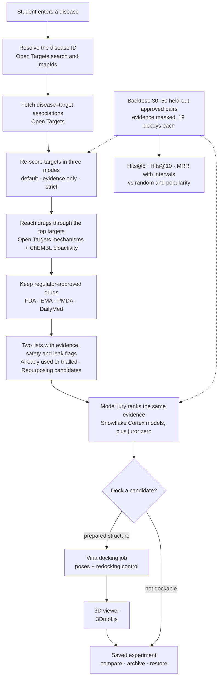
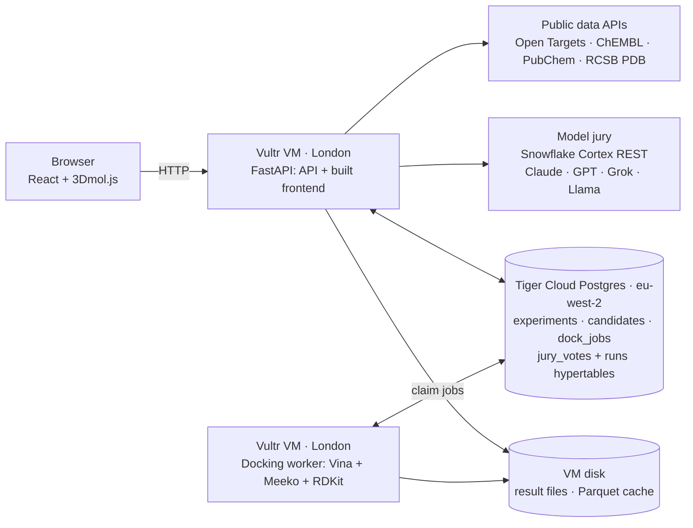

# OxHack '26 build plan

This is the working plan. Each workstream is a numbered list of steps. Do them in order, and agree on the shared contracts in section 6 before splitting up. The research behind each decision is in `reports/OxHack 26 drug repurposing plan.md` and `research_notes/OxHack 26 drug repurposing plan/`. Terms follow `CONTEXT.md`.

## 1. What we are building

A guided web app for students. A user enters any disease, and the app:

1. resolves the disease to an Open Targets ID;
2. finds the disease's targets and scores them in three modes: as published, without trial-derived evidence, and without trial or literature evidence;
3. reaches approved drugs through those targets and splits them into two lists: **Already used or trialled for this disease** and **Repurposing candidates**;
4. shows sourced evidence, approval sources, safety warnings (or "unknown") and leak flags for each candidate;
5. asks a model jury to rank the same candidates from the same evidence, and shows where the models agree and disagree;
6. docks one candidate into a prepared protein structure and shows the binding poses in 3D;
7. saves every experiment so it can be revisited, compared, archived and restored.

The headline result is a **backtest across many diseases**. We hide the direct evidence, then ask how often the pipeline ranks a truly approved drug in its top 5 of 20 candidates. COVID-19 and multiple myeloma are worked examples, not the focus.

**Prize entries:**
- First Place;
- Runner Up;
- [HRT] Best Use of Data for Predictions and Decision Making;
- MLH Best Use of Snowflake API;
- MLH Best Use of Tiger Data;
- MLH Best Use of Vultr.

### Workflow



## 2. Decisions

| Area | Decision |
|---|---|
| Diseases | Any disease. COVID-19 (`MONDO_0100096`) and multiple myeloma (`MONDO_0009693`) are worked examples. |
| Backend | Python 3.11 with FastAPI. A separate docking worker process. |
| Frontend | React, Vite and TypeScript. 3Dmol.js for the 3D viewer. |
| Database | Tiger Cloud Postgres (TimescaleDB), on a trial service in `eu-west-2` (London). |
| Model jury | Four models from one Snowflake account, called through Cortex REST's OpenAI-compatible endpoint. |
| Docking | AutoDock Vina 1.2.7 with Meeko and RDKit, on CPU. Prepared structures only. |
| Hosting | One Vultr VM in London runs the API, the worker and the built frontend. |
| GPU | Not needed for the committed scope, because Vina runs on CPU. Rent a Vultr A40 only for the optional GPU work in section 12. |
| Not building | DiffDock, Boltz-2, GNINA, co-folding models, B200/B300 rental, DGX Spark, docking inside Snowflake, database forks, experiment branching, cross-experiment comparison, new molecules, Gemini, ElevenLabs, Solana, Presage, Delta. |

Abudi's Node test bench (`demos/data-sources/`) stays as a reference for working query text. The production backend is Python, because RDKit, Vina, Meeko, pandas and SciPy are Python libraries.

### Infrastructure



## 3. Ground rules

- **Fresh repo.** MLH prize terms disqualify work done before hacking started, and `prototypes/` predates the start.
  - Create a new public GitHub repo and make its first commit during the event.
  - Copy across only planning text (`plan.md`, `CONTEXT.md`, `docs/mvp-spec.md`, `docs/team-build-plan.md`) and `demos/data-sources/`, which was written during the event.
  - Do not copy `prototypes/` or the primer; rebuild the UI from scratch.
  - Say on Devpost that planning happened before the event and all code was written during it.
- **Pinned queries.** Open Targets 26.09 renamed its drug fields and kept no deprecated aliases, so older queries fail outright.
  - Use only the queries in section 7.
  - Never let an LLM write GraphQL or SQL at runtime.
- **Secrets** live in `.env`, which is gitignored. Commit `.env.example` with variable names only.
- **Timestamps** are stored as `timestamptz` in UTC.
- **Safety.** A drug with no recorded warnings shows "Safety: unknown", never "safe".
- **Approval.** Call a drug approved only when a regulator report backs it (`FDA`, `EMA Human Drugs`, `PMDA` or `DailyMed`). Open Targets stage fields lag behind regulators.
- **Docking scores** never feed the ranking.

## 4. Roles

| Role | Owns |
|---|---|
| A | Evidence pipeline, scoring modes, backtest |
| B | Model jury (Snowflake Cortex), agreement metrics |
| C | Vultr VM, docking worker, prepared structures, 3D viewer |
| D | Frontend, Tiger schema and time-series features, README and Devpost |

## 5. Step 0: setup (everyone, in parallel)

### Repo (D)

1. Create the public repo with this layout:

   ```
   api/
     app/main.py         routes
     app/opentargets.py  pinned GraphQL queries (section 7)
     app/chembl.py       ChEMBL REST calls
     app/pubchem.py      PubChem calls
     app/scoring.py      re-scoring, candidate scores, leak flags
     app/jury.py         jury calls, validation, aggregation
     app/db.py           Postgres access
   worker/
     dock.py prepare.py
     structures/         prepared receptors and boxes, one folder per PDB ID
   backtest/
     build_set.py run.py metrics.py
     frozen/             manifest.json and results
   web/                  React + Vite + TypeScript
   db/schema.sql
   data/                 Parquet cache (gitignored)
   .env.example
   ```

2. Create `.env.example`:

   ```
   DATABASE_URL=
   SNOWFLAKE_ACCOUNT=        # <orgname>-<accountname>
   SNOWFLAKE_PAT=
   RESULTS_DIR=/data/results
   ```

### Snowflake (B)

Done when one REST call returns text.

1. Sign up through the MLH student trial link (`mlh.link/snowflake-signup`).
2. In a worksheet, run:

   ```sql
   SHOW PARAMETERS LIKE 'CORTEX_ENABLED_CROSS_REGION' IN ACCOUNT;
   -- If the value is not ANY_REGION (needs the ACCOUNTADMIN role):
   ALTER ACCOUNT SET CORTEX_ENABLED_CROSS_REGION = 'ANY_REGION';
   SELECT AI_COMPLETE('claude-sonnet-5', 'Reply with the single word OK');
   ```

3. Create a programmatic access token (PAT) as described in the MLH tutorial repo `annafil/cortex-rest-api-demo`, including its network-policy step. Ignore the tutorial's endpoint and model name, which are out of date.
4. Test the REST endpoint:

   ```bash
   curl -s "https://$SNOWFLAKE_ACCOUNT.snowflakecomputing.com/api/v2/cortex/v1/chat/completions" \
     -H "Authorization: Bearer $SNOWFLAKE_PAT" -H "Content-Type: application/json" \
     -d '{"model":"claude-sonnet-5","messages":[{"role":"user","content":"Reply with OK"}]}'
   ```

5. If AI functions are disabled, check Snowflake's trial-account docs: self-service trials need a payment card on the account before AI features work, and adding one does not end the trial. Decide as a team, ask the Snowflake mentor, or use the fallback in section 13.

### Tiger Cloud (D)

Done when `psql "$DATABASE_URL" -c 'select 1'` works.

1. Sign up through `mlh.link/tigerdata-quickstart` (trial with $1,000 credit, no card).
2. Create a service in `eu-west-2` (London). Save the downloaded config file: it is the only time the password is shown.
3. Run `db/schema.sql` from section 6.3.

### Vultr (C)

Done when the VM answers over SSH.

1. Register at `mlh.link/vultr-discover` to get the promo code. Create the Vultr account and enter the code under Billing → Gift Code.
2. Deploy a CPU-optimised VM in London (`lhr`) running Ubuntu LTS, with 8 vCPU and 16 GB.
3. Check whether the credit covers Cloud GPU (A40 in London) and note the answer. It only matters for section 12.
4. Open ports 22, 80 and 8000 in the Vultr firewall.

### Data cache (A)

About 127 MB in total:

```bash
mkdir -p data/ot && cd data/ot
for d in drug_molecule drug_mechanism_of_action drug_warning clinical_indication \
         clinical_target clinical_report disease target; do
  aws s3 sync --no-sign-request \
    "s3://open-targets-public-data-releases/platform/26.09/output/$d/" "$d/"
done
curl -O https://ftp.ebi.ac.uk/pub/databases/chembl/ChEMBLdb/latest/chembl_uniprot_mapping.txt
```

Without the AWS CLI, download the same folders from `http://ftp.ebi.ac.uk/pub/databases/opentargets/platform/26.09/output/`. Inspect the columns before writing joins:

```bash
duckdb -c "DESCRIBE SELECT * FROM 'data/ot/clinical_indication/*.parquet'"
```

## 6. Shared contracts (agree these first)

### 6.1 API

| Method | Path | Returns |
|---|---|---|
| GET | `/api/diseases/search?q=` | Up to 10 `{id, name, description}` |
| POST | `/api/experiments` with `{disease_id}` | New experiment with both candidate lists, scored in all three modes |
| GET | `/api/experiments` | History, excluding archived experiments unless `?archived=true` |
| GET | `/api/experiments/{id}` | One experiment |
| POST | `/api/experiments/{id}/archive`, `/api/experiments/{id}/restore` | Updated experiment |
| POST | `/api/experiments/{id}/jury` with `{mode, condition}` | Jury votes and aggregate |
| GET | `/api/drugs/{chembl_id}/safety` | Warnings and adverse-event signals |
| GET | `/api/structures` | Prepared structures with their targets and controls |
| POST | `/api/dock` with `{experiment_id, drug_chembl_id, pdb_id}` | `202 {job_id}` |
| GET | `/api/dock/{job_id}` | `{status, error, result}` |
| GET | `/api/backtest` | Frozen backtest results |
| GET | `/files/{job_id}/{name}` | Pose and receptor files |

`mode` is `default`, `evidence_only` or `strict` (section 7, step A3). `condition` is `open_book` or `blinded`. The jury defaults to `evidence_only` mode.

### 6.2 Candidate JSON

The frontend builds against fixtures in this shape until the API is ready. The values come from the COVID-19 worked example; `approval_sources` is illustrative.

```json
{
  "drug_chembl_id": "CHEMBL2105759",
  "name": "BARICITINIB",
  "drug_type": "Small molecule",
  "list": "already_used",
  "scores": {
    "default":       {"evidence_score": 0.687, "breadth": 1.23},
    "evidence_only": {"evidence_score": 0.604, "breadth": 1.04},
    "strict":        {"evidence_score": 0.586, "breadth": 1.02}
  },
  "targets": [
    {"ensembl_id": "ENSG00000105397", "symbol": "TYK2", "edge": "bioactivity",
     "median_pchembl": 7.28, "n_assays": 13,
     "datatype_scores": {"genetic_association": 0.96, "literature": 0.60, "clinical": 0.61}},
    {"ensembl_id": "ENSG00000162434", "symbol": "JAK1", "edge": "mechanism",
     "mechanism": "Tyrosine-protein kinase JAK1 inhibitor"}
  ],
  "approval_sources": ["DailyMed"],
  "warnings": [{"type": "Black Box Warning", "class": "vascular toxicity", "country": "United States"}],
  "leak_flags": {"already_indicated_for_disease": true, "reached_via_clinical": false,
                 "named_in_cancer_biomarkers": false},
  "pubchem_cid": 44205240,
  "dockable": true,
  "evidence": [{"id": "E1", "kind": "target_association", "text": "TYK2 ...", "url": "https://platform.opentargets.org/..."}]
}
```

### 6.3 Database schema (`db/schema.sql`)

```sql
CREATE TABLE experiments (
  id             uuid PRIMARY KEY DEFAULT gen_random_uuid(),
  disease_id     text NOT NULL,
  disease_name   text NOT NULL,
  ot_release     text NOT NULL DEFAULT '26.09',
  chembl_release text NOT NULL DEFAULT 'ChEMBL_37',
  jury_models    text[] NOT NULL DEFAULT '{}',
  archived       boolean NOT NULL DEFAULT false,
  created_at     timestamptz NOT NULL DEFAULT now()
);

CREATE TABLE candidates (
  experiment_id  uuid NOT NULL REFERENCES experiments(id),
  drug_chembl_id text NOT NULL,
  name           text NOT NULL,
  list           text NOT NULL CHECK (list IN ('already_used', 'repurposing')),
  payload        jsonb NOT NULL,          -- the candidate JSON from 6.2
  PRIMARY KEY (experiment_id, drug_chembl_id)
);

CREATE TABLE evidence_cache (
  cache_key  text PRIMARY KEY,            -- e.g. 'assoc:MONDO_0100096:26.09'
  payload    jsonb NOT NULL,
  fetched_at timestamptz NOT NULL DEFAULT now()
);

CREATE TABLE dock_jobs (
  id             uuid PRIMARY KEY DEFAULT gen_random_uuid(),
  experiment_id  uuid REFERENCES experiments(id),
  session_id     text,
  cache_key      text NOT NULL,
  pdb_id         text NOT NULL,
  drug_chembl_id text NOT NULL,
  smiles         text NOT NULL,
  params         jsonb NOT NULL,          -- box, exhaustiveness, seed, versions
  status         text NOT NULL DEFAULT 'queued'
                 CHECK (status IN ('queued', 'running', 'done', 'failed')),
  error          text,
  result         jsonb,                   -- file names, scores, RMSD if a control
  created_at     timestamptz NOT NULL DEFAULT now(),
  started_at     timestamptz,
  finished_at    timestamptz
);
CREATE INDEX ON dock_jobs (status, created_at);
CREATE UNIQUE INDEX dock_jobs_done_cache ON dock_jobs (cache_key) WHERE status = 'done';

CREATE TABLE backtest_registrations (
  id         uuid PRIMARY KEY DEFAULT gen_random_uuid(),
  sha256     text NOT NULL,
  manifest   jsonb NOT NULL,
  created_at timestamptz NOT NULL DEFAULT now()
);

-- Time-series tables (Tiger prize)
CREATE TABLE jury_votes (
  ts              timestamptz NOT NULL DEFAULT now(),
  run_id          uuid NOT NULL,
  experiment_id   uuid,
  backtest_id     uuid,
  mode            text NOT NULL,
  condition       text NOT NULL,          -- open_book | blinded
  model           text NOT NULL,
  drug_chembl_id  text NOT NULL,
  rank            int,
  score           double precision,
  decision        text,
  citations_total int,
  citations_valid int,
  latency_ms      int,
  input_tokens    int,
  output_tokens   int
);
SELECT create_hypertable('jury_votes', by_range('ts'));

CREATE TABLE runs (
  ts            timestamptz NOT NULL DEFAULT now(),
  run_id        uuid NOT NULL,
  experiment_id uuid,
  kind          text NOT NULL,            -- pipeline | jury | dock | backtest
  duration_ms   int,
  ok            boolean NOT NULL,
  detail        jsonb
);
SELECT create_hypertable('runs', by_range('ts'));

CREATE MATERIALIZED VIEW jury_activity
WITH (timescaledb.continuous, timescaledb.materialized_only = false) AS
SELECT time_bucket(INTERVAL '5 minutes', ts) AS bucket, model, condition,
       count(*) AS votes,
       avg(citations_valid::float / NULLIF(citations_total, 0)) AS citation_validity,
       avg(latency_ms) AS avg_latency_ms
FROM jury_votes
GROUP BY bucket, model, condition;
SELECT add_continuous_aggregate_policy('jury_activity',
  start_offset => INTERVAL '1 day', end_offset => INTERVAL '1 minute',
  schedule_interval => INTERVAL '1 minute');

-- Columnstore compression (TimescaleDB 2.18 and later)
ALTER TABLE jury_votes SET (timescaledb.enable_columnstore = true,
                            timescaledb.segmentby = 'model');
CALL add_columnstore_policy('jury_votes', after => INTERVAL '1 day');
-- If these two statements error on the service's version, use the older API instead:
--   ALTER TABLE jury_votes SET (timescaledb.compress, timescaledb.compress_segmentby = 'model');
--   SELECT add_compression_policy('jury_votes', INTERVAL '1 day');
```

After the backtest runs, compress the vote chunks and show the size before and after on the history page:

```sql
SELECT compress_chunk(c, if_not_compressed => true) FROM show_chunks('jury_votes') c;
SELECT * FROM hypertable_columnstore_stats('jury_votes');  -- or hypertable_compression_stats
```

### 6.4 Jury output schema

```json
{
  "type": "object",
  "properties": {
    "rankings": {
      "type": "array",
      "items": {
        "type": "object",
        "properties": {
          "candidate_id":          {"type": "string"},
          "rank":                  {"type": "integer"},
          "score":                 {"type": "number"},
          "decision":              {"type": "string", "enum": ["investigate", "watch", "deprioritise"]},
          "supporting_ids":        {"type": "array", "items": {"type": "string"}},
          "contradicting_ids":     {"type": "array", "items": {"type": "string"}},
          "insufficient_evidence": {"type": "boolean"},
          "rationale":             {"type": "string"}
        },
        "required": ["candidate_id", "rank", "score", "decision", "supporting_ids",
                     "contradicting_ids", "insufficient_evidence", "rationale"],
        "additionalProperties": false
      }
    }
  },
  "required": ["rankings"],
  "additionalProperties": false
}
```

## 7. Workstream A: evidence pipeline and backtest

All Open Targets calls go to `POST https://api.platform.opentargets.org/api/v4/graphql` with the body `{"query": ..., "variables": ...}`. Batch target and drug lookups (25 to 200 IDs per call): Open Targets asks users not to query one entity at a time. Cache every response in `evidence_cache`.

**A1. Resolve the disease.**

Use `search` for the picker:

```graphql
query SearchDisease($q: String!) {
  search(queryString: $q, entityNames: ["disease"], page: {index: 0, size: 10}) {
    total hits { id name entity description score } } }
```

Use `mapIds` for exact names:

```graphql
query MapIds($terms: [String!]!) {
  mapIds(queryTerms: $terms, entityNames: ["disease"]) {
    total mappings { term hits { id name entity score } } } }
```

- Always show the resolved ID and label. They can differ from what the user typed: "multiple myeloma" resolves to "plasma cell myeloma", and the partial term "covid" ranks long COVID first.
- When loading a saved experiment, check `disease(efoId: $id) { obsoleteTerms }` for retired IDs.

**A2. Fetch all associations.** Pages hold at most 3000 rows. Loop `index` until all `count` rows are fetched:

```graphql
query Assoc($id: String!, $i: Int!, $size: Int!) {
  disease(efoId: $id) {
    associatedTargets(page: {index: $i, size: $size}) {
      count
      rows { target { id approvedSymbol } score
             datatypeScores { id score } datasourceScores { id score } } } } }
```

**A3. Re-score client-side, in three modes.** Do not use the server-side `datasources` argument: it replaces the whole weight table instead of changing one weight.

```python
import math

NORM = math.pi ** 2 / 6
# Non-default Open Targets weights; every other datasource has weight 1.0.
DEFAULT_WEIGHTS = {"europepmc": 0.2, "expression_atlas": 0.2, "impc": 0.2,
                   "cancer_biomarkers": 0.5, "ot_crispr_validation": 0.5,
                   "ot_crispr": 0.5, "encore": 0.5}
DROP = {
    "default": set(),
    "evidence_only": {"clinical_precedence", "cancer_biomarkers"},
    "strict": {"clinical_precedence", "cancer_biomarkers", "europepmc"},
}

def target_score(datasource_scores, mode):
    weighted = [DEFAULT_WEIGHTS.get(d["id"], 1.0) * d["score"]
                for d in datasource_scores if d["id"] not in DROP[mode]]
    return sum(v / i ** 2 for i, v in enumerate(sorted(weighted, reverse=True), 1)) / NORM
```

- **Unit test:** in `default` mode, every row must match the API's `score` within 0.0001.
- `clinical_precedence` comes from trials of drugs in the disease. `cancer_biomarkers` rows can name the drug itself. `europepmc` is literature co-mentions.

**A4. Drugs already used or trialled for the disease.** These rows form the first list and set the `already_indicated_for_disease` flag:

```graphql
query DiseaseDrugs($id: String!) {
  disease(efoId: $id) {
    drugAndClinicalCandidates {
      count
      rows {
        id maxClinicalStage
        drug { id name drugType maximumClinicalStage parentMolecule { id name }
               mechanismsOfAction { rows { mechanismOfAction actionType targets { id approvedSymbol } } } }
        clinicalReports { id source clinicalStage trialOverallStatus trialStartDate url title } } } } }
```

- There is no pagination: the response can be about 3 MB, so cache it.
- `ClinicalReport.year` is null; use `trialStartDate`.

**A5. Reach drugs through targets.** Take the top 100 targets by the mode's score and fan out with 25 IDs per call:

```graphql
query TargetDrugs($ids: [String!]!) {
  targets(ensemblIds: $ids) {
    id approvedSymbol
    drugAndClinicalCandidates {
      count
      rows { id maxClinicalStage
             drug { id name drugType maximumClinicalStage parentMolecule { id name } }
             diseases { diseaseFromSource disease { id name } } } } } }
```

- Collapse salts and hydrates onto `drug.parentMolecule.id`, falling back to `drug.id`.
- One known bad edge: deuruxolitinib is parented to ruxolitinib, so show both names.
- `row.maxClinicalStage` is the stage for that target–drug pair; `drug.maximumClinicalStage` is the stage across all indications.

**A6. Check approval provenance.** Batch 25 drugs per call:

```graphql
query DrugApprovals($ids: [String!]!) {
  drugs(chemblIds: $ids) {
    id name drugType maximumClinicalStage
    indications { rows { maxClinicalStage disease { id name }
                         clinicalReports { source clinicalStage } } } } }
```

Keep a drug only if it has an indication row at `APPROVAL` whose reports include a source in {`FDA`, `EMA Human Drugs`, `PMDA`, `DailyMed`}. This removes never-approved drugs such as navitoclax, which Open Targets shows at `APPROVAL`. Store the matching sources as `approval_sources`.

**A7. Add bioactivity edges (small molecules only).** Open Targets mechanism data alone misses targets: for example, baricitinib's mechanism lists only JAK1 and JAK2, although it also potently inhibits TYK2. For each candidate:

```
GET https://www.ebi.ac.uk/chembl/api/data/activity.json?molecule_chembl_id={id}&pchembl_value__gte=5&target_organism=Homo%20sapiens&limit=1000&only=target_chembl_id,pchembl_value
```

- Group the activities by target and keep targets with a median pChEMBL of at least 7.
- **ChEMBL target to gene symbol:** call `/target.json?target_chembl_id__in={ids}`.
  - Keep only `target_type == "SINGLE PROTEIN"`.
  - Read the symbol from `target_components[].target_component_synonyms[]` where `syn_type == "GENE_SYMBOL"`.
- **Gene symbol to Ensembl ID:** use `mapIds` with `entityNames: ["target"]`.
- `limit` is capped at 1000, so follow `page_meta.next`. Cache results per drug.

**A8. Score candidates (this is "juror zero").** For each drug, take its targets (mechanism and bioactivity) in each mode:

- `evidence_score` = the highest target score;
- `breadth` = the sum of target scores, used only to break ties.

Sort by `(evidence_score, breadth)`. The UI shows every supported target, with no other bonus for hitting more targets.

**A9. Set the leak flags.**
- `already_indicated_for_disease`: the drug (parent ID) appears in A4.
- `reached_via_clinical`: the `evidence_only` score is less than half the `default` score.
- `named_in_cancer_biomarkers`: a `cancer_biomarkers` evidence row for one of the drug's targets in this disease names the drug.
  - Query `disease(efoId) { evidences(ensemblIds: [...], datasourceIds: ["cancer_biomarkers"], size: 50) { ... } }`.
  - Confirm the drug field name with schema introspection before relying on it.

**A10. Build evidence items** (`E1`, `E2`, …) per candidate, for the UI and the jury:

- **Target association:** symbol, mode score and datatype breakdown, linked to `https://platform.opentargets.org/evidence/{ensembl_id}/{disease_id}`.
- **Mechanism:** the `mechanismOfAction` sentence plus its references.
- **Bioactivity:** "median pChEMBL X across N human assays", linked to the ChEMBL compound page.
- **Safety:** the `drugWarnings` lines, or "No warnings recorded: safety unknown". Fetch adverse events lazily for the selected drug only, because they are slow:

  ```graphql
  query DrugSafety($id: String!) {
    drug(chemblId: $id) {
      id name drugWarnings { warningType toxicityClass country year references { id source url } }
      adverseEvents(page: {index: 0, size: 10}) { count criticalValue rows { name count logLR } } } }
  ```

  Adverse events are reporting signals (`logLR` against `criticalValue`), not incidence rates.
- **Trials for this disease:** in `default` mode only. Never include trials, indications or literature for the disease in `evidence_only` or `strict` packets.

**A11. Fetch structure images from PubChem.** Look drugs up by InChIKey from ChEMBL (`molecule_structures.standard_inchi_key`):

- `https://pubchem.ncbi.nlm.nih.gov/rest/pug/compound/inchikey/{key}/cids/JSON` returns the CID.
- `/compound/cid/{cid}/PNG?image_size=400x400` returns the 2D drawing, usable directly as ``.
- Property responses use the keys `SMILES` and `ConnectivitySMILES`, not `CanonicalSMILES`.
- Antibodies have no CID: skip them and set `dockable: false`.

**A12. Run the backtest (the HRT number).**

1. **Positives.** Prefer KG-Bench's time split (Wei et al., *Bioinformatics* 2026, btag159), so the held-out pairs are approvals added after the evidence snapshot.
   - **Source:** indications that are new in Open Targets 23.06 or 24.06 compared with 21.06. Their code (`github.com/cmbi/Benchmark_GNN_OpenTargets`, MIT licence) builds this list from the raw `indication` Parquet files of those releases. Check those files are still on the Open Targets FTP.
   - **Fallback:** if the old files are unavailable, list drug–disease pairs from our Parquet cache with an `APPROVAL` row backed by a regulator report.
   - **Selection:**
     - Pick 30–50 pairs, one per disease, spread across at least five therapeutic areas (50 gives tighter intervals).
     - Keep only regulator-backed approvals and prefer small molecules.
     - Skip diseases with fewer than 20 associated targets.
   - **Caveat:** KG-Bench's split is by curation date, and about 450 links arrive in a single release (22.04), so "new" means newly curated, not newly approved.
2. **Decoys.** For each pair, draw 19 regulator-approved drugs that have no candidate row for that disease at any stage.
   - Also exclude its parent and child disease terms where the disease table lists them.
   - Match on popularity: count each approved drug's approved indications, split all approved drugs into five equal bins by that count, and draw decoys from the positive's bin with a fixed seed.
3. **Mask.** Score targets in `strict` mode and build evidence packets without any trial, indication or literature item for the pair.
4. **Freeze.** Write the pairs, decoys, seeds, prompts and model list to `backtest/frozen/manifest.json`. Insert its SHA-256 into `backtest_registrations` before running anything. If the manifest must change, register a new one and keep both.
5. **Pilot.** Run 10 pairs end to end and fix bugs, then run the full set.
6. **Rankers:**
   - random (analytical);
   - popularity;
   - shared-target count: how many of the drug's targets have any `strict`-mode association with the disease. On KG-Bench's shipped graph this rule alone separates known from random drug–disease pairs at AUC 0.848 with no model, close to their GNNs' reported test AUC of 0.84–0.91. It is the bar every smarter ranker must beat;
   - juror zero (A8, `strict` mode);
   - optionally, KG-Bench's best GNN (RGCN) scored on the same 20-candidate pools (section 12);
   - each LLM in `blinded` and `open_book` conditions, with two candidate orders each;
   - jury consensus.
7. **Metrics.** Per disease, record the rank of the true drug. Report Hits@1, Hits@5, Hits@10 and MRR, each with a 95% bootstrap interval over diseases (1,000 resamples). Add a paired bootstrap of the difference against popularity. Chance levels are 0.05, 0.25 and 0.50 for Hits@1, @5 and @10, and about 0.18 for MRR.

   ```python
   import numpy as np

   def metrics(ranks):  # 1-based rank of the true drug, one value per disease
       r = np.asarray(ranks)
       return {"hits@1": (r <= 1).mean(), "hits@5": (r <= 5).mean(),
               "hits@10": (r <= 10).mean(), "mrr": (1 / r).mean()}

   def bootstrap_ci(ranks, key, n=1000, seed=0):
       rng = np.random.default_rng(seed)
       r = np.asarray(ranks)
       values = [metrics(rng.choice(r, len(r)))[key] for _ in range(n)]
       return np.percentile(values, [2.5, 97.5])
   ```

8. **Labels.** Label `open_book` results "may reflect what the models memorised". The `blinded` result is the main jury number.

**Done when:** `GET /api/backtest` returns the manifest hash, the number of pairs, and every ranker's metrics with intervals.

## 8. Workstream B: model jury

**B1. Set up the client.** Use the OpenAI Python SDK against Snowflake's endpoint:

```python
from openai import OpenAI

snowflake = OpenAI(base_url=f"https://{SNOWFLAKE_ACCOUNT}.snowflakecomputing.com/api/v2/cortex/v1",
                   api_key=SNOWFLAKE_PAT)

JURORS = [
    (snowflake, "claude-sonnet-5"),
    (snowflake, "openai-gpt-5.4"),
    (snowflake, "grok-4.7"),      # preview; kimi-k3 or glm-5.3 are alternatives
    (snowflake, "llama3.1-8b"),   # deliberately small baseline
]
```

- Avoid Mistral and Llama 70B on Snowflake REST. They are legacy models, and a new account cannot start using them.
- If a preview model fails, drop it rather than debugging it.

**B2. Build the evidence packet.**
- Candidate IDs are `C1` to `Cn`. Each candidate carries its `E#` items from A10.
- The app sends the top 15 repurposing candidates in the chosen mode. The backtest sends the 20 candidates from A12.
- In the `blinded` condition, replace drug names, trade names and synonyms with `Drug A`, `Drug B` and so on everywhere. Keep targets and mechanisms.
- Shuffle the candidate order per juror and record the seed.

**B3. Prompt.** Use this system message:

> You are one member of a panel ranking existing approved drugs as hypotheses worth further study for {disease}. Use only the evidence items provided; do not use outside knowledge. Rank every candidate exactly once (1 = most worth investigating). For each candidate give a score from 0 to 1, a decision (investigate, watch or deprioritise), the evidence IDs that support it and the IDs that argue against it, and a rationale of at most 40 words in which every sentence ends with an evidence ID in square brackets, like [E12]. If the evidence is too thin to judge, set insufficient_evidence to true. Reasons to deprioritise are as useful as reasons to investigate.

- The user message is the packet JSON.
- Set `temperature=0`.
- Set `response_format={"type": "json_schema", "json_schema": {"name": "jury_ranking", "strict": True, "schema": SCHEMA}}`, using the schema from 6.4.
- If a model rejects strict schemas, fall back to JSON mode; the validator still checks every reply.

**B4. Validate in code.**
- The reply is valid JSON that matches the schema.
- The ranks are a permutation of 1 to n, and every candidate appears exactly once.
- Every ID in `supporting_ids`, `contradicting_ids` and the rationale exists in the packet.
- Every rationale sentence ends with an `[E#]`.

On failure, re-ask once with the list of errors. On a second failure, drop that juror for the run and record why. Store `citations_total` and `citations_valid` on every vote. The UI shows the citation-validity rate, and an invented ID is flagged red.

**B5. Aggregate.**
- **Consensus:** Borda count (each juror gives `n − rank` points). Juror zero breaks ties.
- **Agreement:** Kendall's W across m jurors and n candidates: `W = 12·S / (m²·(n³ − n))`, where `S = Σ_i (R_i − m(n+1)/2)²` and `R_i` is candidate i's rank sum. Also show pairwise Kendall τ (`scipy.stats.kendalltau`) and top-3 overlap.
- **Contested:** jurors' decisions differ, or the rank spread (max − min) is 5 or more.
- **Juror zero** appears as a separate column and is left out of W.
- **Wording:** agreement means "the models concur on this evidence", never confidence or probability.

**B6. Log.** Write every vote to `jury_votes` and every call to `runs`, including latency and token counts.

**B7. Backtest calls (with A).** One call per disease, juror, condition and candidate order: 50 × 4 × 2 × 2 = 800 calls. Retry HTTP 429 with exponential backoff.

**Done when:** one experiment shows a heatmap of 4 jurors by candidates, plus Kendall's W, contested flags, citation validity and decision labels.

## 9. Workstream C: docking and viewer

**C1. Install** on the VM, and on a Mac for local testing:

```bash
sudo apt-get update && sudo apt-get install -y python3-venv python3-pip git
python3 -m venv ~/dock && source ~/dock/bin/activate
pip install -U numpy scipy rdkit vina meeko gemmi prody posebusters
python -c "import vina, rdkit; print(vina.__version__, rdkit.__version__)"
```

If `pip install vina` fails to build, try either of these:
- conda-forge: `micromamba create -n dock -c conda-forge python=3.11 vina meeko rdkit gemmi prody`;
- the official `vina_1.2.7_linux_x86_64` or `vina_1.2.7_mac_aarch64` binary from the AutoDock-Vina GitHub releases.

Record the Vina, Meeko and RDKit versions; the UI shows them, because one RDKit version change halved a published docking benchmark result.

**C2. Prepare structures.** Start with these entries. All are non-covalent and verified on RCSB:

| PDB | Target | Co-crystal ligand (component ID) | Use |
|---|---|---|---|
| 6WTO | JAK2 kinase domain, 1.74 Å | baricitinib (`3JW`) | Redocking control; JAK-family candidates |
| 6WTN | JAK2 kinase domain, 1.83 Å | ruxolitinib (`RXT`) | Cross-docking control |
| 6O0K | BCL2, 1.62 Å | venetoclax (`LBM`) | Myeloma worked example |
| 7BQU | CRBN with SALL4, 1.9 Å | S-thalidomide (`EF2`) | Small and quick to dock |

Add two or three more from the backtest and demo diseases. Each one needs:
- a human protein;
- an X-ray structure at 2.5 Å or better;
- one chain around the pocket;
- a non-covalent, drug-like co-crystal ligand;
- at least one approved small molecule acting on that target.

Find entries with the RCSB search below. It returns structures of a UniProt protein that have a bound ligand, sorted by resolution; RCSB returns HTTP 204 when nothing matches.

```json
{"query": {"type": "group", "logical_operator": "and", "nodes": [
  {"type": "terminal", "service": "text", "parameters": {
     "attribute": "rcsb_polymer_entity_container_identifiers.reference_sequence_identifiers.database_accession",
     "operator": "exact_match", "value": "<UniProt accession>"}},
  {"type": "terminal", "service": "text", "parameters": {
     "attribute": "rcsb_entry_info.nonpolymer_entity_count", "operator": "greater", "value": 0}}]},
 "return_type": "entry",
 "request_options": {"paginate": {"start": 0, "rows": 5}, "results_content_type": ["experimental"],
   "sort": [{"sort_by": "rcsb_entry_info.resolution_combined", "direction": "asc"}]}}
```

POST it to `https://search.rcsb.org/rcsbsearch/v2/query`.

Avoid the 20S proteasome (5LF3 and similar), XPO1, and any entry where the drug is bound covalently.

**C3. Prepare a receptor** with `worker/prepare.py`. Run it once per structure and commit the outputs to `worker/structures/{PDB}/`.

1. Download `https://files.rcsb.org/download/{PDB}.pdb`.
2. Keep the chosen chain. Remove waters, ions and all ligands, using gemmi or ProDy.
3. Add hydrogens and write the receptor PDBQT with Meeko's `mk_prepare_receptor.py`. Follow the Vina "basic docking" tutorial for the flags that match the installed Meeko version (`mk_prepare_receptor.py --help`).
4. Download the crystal ligand pose from `https://models.rcsb.org/v1/{PDB}/ligand?label_comp_id={COMP}&encoding=sdf`. The box centre is the ligand's heavy-atom centroid; the box is a 25 Å cube.
5. Write `meta.json` containing `pdb_id`, `chain`, `uniprot`, `symbol`, `ligand_comp_id`, `box_center`, `box_size` and `control_smiles`.

**C4. Prepare a ligand.** Take the SMILES from ChEMBL (`molecule_structures.canonical_smiles`):

```python
from rdkit import Chem
from rdkit.Chem import AllChem

mol = Chem.AddHs(Chem.MolFromSmiles(smiles))
AllChem.EmbedMolecule(mol, randomSeed=42)
AllChem.MMFFOptimizeMolecule(mol)
Chem.MolToMolFile(mol, "ligand.sdf")
```

Then run `mk_prepare_ligand.py -i ligand.sdf -o ligand.pdbqt`.

**C5. Dock** with `worker/dock.py`:

```python
from vina import Vina

v = Vina(sf_name="vina", seed=42)
v.set_receptor("receptor.pdbqt")
v.set_ligand_from_file("ligand.pdbqt")
v.compute_vina_maps(center=box_center, box_size=[25, 25, 25])
v.dock(exhaustiveness=8, n_poses=9)
v.write_poses("poses.pdbqt", n_poses=9, overwrite=True)
energies = v.energies(n_poses=9)  # column 0 is the total score per pose
```

- Convert poses to SDF with `mk_export.py poses.pdbqt -s poses.sdf`.
- Write `scores.json` and `log.txt` alongside.
- Before wiring the queue, measure runtime on the VM at exhaustiveness 8, 16 and 32. Pick the highest setting that stays well inside the job timeout.

**C6. Redocking control.** Ship it as a visible feature.

1. Dock the crystal ligand's SMILES into its own prepared structure, with the same box and settings as user jobs.
2. Compute the RMSD of the top pose to the crystal pose: symmetry-aware, heavy atoms, no realignment.

   ```python
   from rdkit import Chem
   from rdkit.Chem import AllChem, rdMolAlign

   ref = Chem.MolFromMolFile("crystal_ligand.sdf")
   ref = AllChem.AssignBondOrdersFromTemplate(Chem.MolFromSmiles(control_smiles), ref)
   pose = Chem.RemoveHs(next(Chem.SDMolSupplier("poses.sdf")))
   rmsd = rdMolAlign.CalcRMS(pose, Chem.RemoveHs(ref))  # success if rmsd <= 2.0
   ```

3. Run PoseBusters: `bust poses.sdf -l crystal_ligand.sdf -p receptor.pdb`. Show pass or fail per check group.
4. **Negative control:** dock an unrelated approved drug into the same box. The viewer still draws a convincing-looking pose, which shows why a pose is not evidence.
5. The control card reads: "Redocking control: baricitinib into 6WTO, RMSD = X.X Å (success ≤ 2.0 Å), PoseBusters: PASS". Fill in real numbers only.

**C7. Job queue** (Postgres only, no broker).

1. `POST /api/dock` checks that the PDB is in the prepared set and the drug is `dockable`.
2. It computes `cache_key` = SHA-256 of (pdb_id, chain, canonical SMILES, box, engine, engine version, exhaustiveness, seed).
   - If a `done` job with that key exists, return it at once.
   - Otherwise insert a `queued` row and return `202 {job_id}`.
   - Allow at most 3 queued jobs per session.
3. The worker loop claims a job with:

   ```sql
   UPDATE dock_jobs SET status = 'running', started_at = now()
   WHERE id = (SELECT id FROM dock_jobs WHERE status = 'queued'
               ORDER BY created_at FOR UPDATE SKIP LOCKED LIMIT 1)
   RETURNING *;
   ```

4. Each job has a hard timeout of 180 seconds. On timeout or error, set `failed` with the last lines of stderr. The rest of the experiment stays saved.
5. Files go to `$RESULTS_DIR/{job_id}/` (`receptor.pdb`, `poses.sdf`, `scores.json`, `log.txt`) and are served from `/files/{job_id}/{name}`. Postgres stores metadata and scores, never file contents.

**C8. Viewer.** A starting point for React and 3Dmol.js. Check the import path against the installed `3dmol` version.

```tsx
import { useEffect, useRef } from "react";
import * as $3Dmol from "3dmol";

type Props = { receptorPdb: string; posesSdf: string; poseIndex: number; showSurface: boolean };

export function PoseViewer({ receptorPdb, posesSdf, poseIndex, showSurface }: Props) {
  const el = useRef<HTMLDivElement>(null);
  const viewer = useRef<any>(null);

  useEffect(() => {
    viewer.current = $3Dmol.createViewer(el.current!, { backgroundColor: "white" });
    return () => viewer.current?.clear();
  }, []);

  useEffect(() => {
    const v = viewer.current;
    if (!v) return;
    v.clear();
    const receptor = v.addModel(receptorPdb, "pdb");
    receptor.setStyle({}, { cartoon: { color: "spectrum" } });
    const poses = posesSdf.split("$$$$").filter((s) => s.trim());
    const ligand = v.addModel(poses[poseIndex] + "$$$$\n", "sdf");
    ligand.setStyle({}, { stick: {} });
    if (showSurface) {
      v.addSurface($3Dmol.SurfaceType.VDW, { opacity: 0.6 },
        { model: receptor, within: { distance: 8, sel: { model: ligand } } });
    }
    v.zoomTo({ model: ligand });
    v.render();
  }, [receptorPdb, posesSdf, poseIndex, showSurface]);

  return <div ref={el} style={{ width: "100%", height: 480, position: "relative" }} />;
}
```

Keep the viewer instance in a ref, never in React state. Compute the surface only near the pocket and only when toggled on.

**C9. Pre-run the cache before judging.** Run and store every prepared structure's control, plus each demo pair (for example baricitinib → 6WTO and venetoclax → 6O0K), so nothing is computed for the first time during the demo.

**UI wording.** Use close to verbatim:
- **Next to the pose:** "This is a predicted binding pose: a geometric hypothesis for how this molecule could sit in this pocket of this particular crystal structure. It is not evidence that the drug binds this target, and it is not a prediction of clinical effect."
- **Next to the score:** "The docking score is a rough, unitless estimate of fit. It is not a measured binding affinity, it does not convert reliably to Kd or IC50, and scores are only loosely comparable between different ligands."
- **Next to the control:** "We validate the pipeline by re-docking a ligand whose true position is known from the crystal structure. A low RMSD means our setup reproduces a known answer; it says nothing about the novel pairs you explore."

**Done when:** `POST /api/dock` for a prepared pair returns 202 and the job finishes. The viewer must show the poses with a pose selector and a surface toggle, and the control card must show the real RMSD and PoseBusters result.

## 10. Workstream D: frontend, history and Tiger features

**D1. Scaffold.** Run `npm create vite@latest web -- --template react-ts`, then `npm install 3dmol`. Build against fixtures in `web/src/fixtures/` that match 6.2 until the API is ready.

**D2. Screens.**

1. **Search:** a disease box with suggestions, showing the resolved ID and label.
2. **Experiment:**
   - **Guided-mode explanation for each stage:** disease → targets → drugs → evidence → jury → docking.
   - **Mode switch:** Default / Evidence only / Strict, with rank changes highlighted.
   - **Two lists:** "Already used or trialled for this disease" and "Repurposing candidates".
   - **Candidate card:**
     - 2D drawing and mechanism sentence;
     - targets with datatype bars;
     - leak flags and approval sources;
     - safety (warnings or "unknown") and evidence links.
   - **Jury panel:**
     - heatmap of models by candidates;
     - consensus rank and Kendall's W;
     - contested flags and citation validity;
     - a juror-zero column and decision labels.
3. **Candidate comparison** (within one experiment): evidence, warnings, jury view and docking results side by side.
4. **Docking panel:**
   - a structure picker listing prepared structures only, with others disabled and the reason shown;
   - job status (queued, running, done, failed);
   - the viewer and the control card;
   - the wording from section 9.
5. **History:** a list of experiments with archive and restore. Disable archive while a docking job is running.
6. **Backtest:** the result card (section 14), a metrics table with intervals for every ranker, and the manifest hash.
7. **Empty and error states:**
   - no matching disease;
   - no targets;
   - no approved drugs reached;
   - antibodies only (not dockable);
   - a model failed;
   - docking failed, with the rest of the experiment still saved.

**D3. Tiger features.**
- Add a "Jury activity" panel that reads the `jury_activity` continuous aggregate and shows its query time.
- Show the compression before/after numbers from 6.3.
- Keep these visible in the demo; the prize asks for performance-driven time-series use.

**D4. Deploy on the Vultr VM.**
- Run `npm run build` and serve `web/dist` from FastAPI, mounted after the API routes: `app.mount("/", StaticFiles(directory="web/dist", html=True))`.
- Run the API and the worker as two `systemd` services.

**D5. Write the README.** It covers:
- what the app does and how to run it;
- the architecture;
- data sources and versions (Open Targets 26.09, ChEMBL 37);
- how each sponsor is used (Snowflake, Tiger Data, Vultr);
- the backtest card;
- limits and the disclaimer;
- every AI tool used.

## 11. Integration milestones (in order)

| # | Milestone | Done when |
|---|---|---|
| M1 | Accounts and contracts | Cortex REST call returns; Tiger schema loaded; VM reachable; section 6 agreed |
| M2 | Evidence pipeline | `POST /api/experiments` works for 3 diseases from different therapeutic areas, in all three modes; default re-score matches the API |
| M3 | Jury | 4 jurors return validated rankings for one experiment; W, contested flags and citation validity computed |
| M4 | Pilot backtest | 10 frozen pairs produce metrics for every ranker |
| M5 | Docking | Redocking control passes on 6WTO; a user job completes through the queue and shows in the viewer |
| M6 | Full integration | Full backtest frozen and displayed; history, archive and restore work; app deployed on Vultr |
| M7 | Rehearsal | Two complete demo run-throughs on the demo laptop with no fixes needed |

## 12. Optional, only after M6

Do these only if M6 is done and the Vultr credit covers an A40:

- **GPU batch screen:** dock every approved small molecule against one prepared target with a GPU Vina variant (Uni-Dock) on a Vultr A40. Report how well known ChEMBL actives rise to the top (AUROC). Present it as an illustration.
- **Second docking engine:** call NVIDIA's hosted DiffDock for one prepared pair, and show it beside Vina with both RMSD and PoseBusters results.
- **KG-Bench GNN as an extra ranker.**
  1. Clone `github.com/cmbi/Benchmark_GNN_OpenTargets` and download the 21.06, 23.06 and 24.06 `indication` Parquet files.
  2. Build the graph and train RGCN only. Skip the GNNExplainer step, which is slow.
  3. Check the log prints "New validation edges" and "New test edges", and **not** "Using random splits". Without the raw files, the script quietly builds random splits.
  4. Score each 20-candidate backtest pool with the trained model and add it as a ranker.
  - **Install risk:** `torch-scatter` and `torch-sparse`. Use the Linux VM rather than a Mac.
  - **Caveats:**
    - The shipped `processed_data/` does not match the paper: 1,116 drug–disease edges against 996, and 103,921 disease–gene edges against 72,977.
    - Their disease–gene edges use Open Targets overall scores, which include clinical-trial evidence (`scripts/1_create_graph.py` lines 65 and 452). That is the same leak as our `default` mode, so report RGCN as "uses trial evidence".

## 13. Fallbacks

| If | Then |
|---|---|
| Snowflake AI stays unavailable | Point the same OpenAI-compatible client at any LLM API the team already has access to, and drop the Snowflake prize entry |
| Vultr credit does not cover GPUs | Nothing changes: the committed scope runs on CPU |
| Vultr is unavailable | Run the API and worker on a laptop (Vina runs natively on Apple silicon), and drop the Vultr entry |
| Open Targets is slow or down | Serve from the Parquet cache and the cached association rows |
| The pilot backtest will not run | Ship the three-mode comparison for 3+ diseases with rank changes and jury agreement, and describe exactly what was measured |
| Live docking is unstable | Serve cached jobs for prepared pairs and disable new requests with an explanation |

## 14. Demo and claims

**Demo order:**

1. **Backtest card:** "Across N held-out pairs in M diseases, with direct evidence hidden, the jury ranked the true drug in its top 5 for k of N (x%, 95% CI a–b%). Chance is 25%; popularity gets y%."
2. **Live disease:** a judge picks any disease. A list of cached diseases is the fallback.
3. **Modes:** switch Default → Evidence only, and point at the leak flags and rank changes.
4. **Jury:** show agreement, contested candidates and a rejected citation.
5. **Docking:** dock a candidate into a prepared structure, then show the redocking control.
6. **History:** show that the experiment is saved, then archive and restore it.

**Result card template** (fill only with real outputs):

> Retrospective check, frozen ([hash]): [N] drug–disease approvals, each hidden among 19 popularity-matched approved drugs, with trial, indication and literature evidence removed. The blinded jury consensus ranked the true drug in its top 5 for [k]/[N] diseases ([x]%, 95% CI [a–b]%). Chance is 25%; the popularity baseline is [y]%. LLM jurors may have seen some of these approvals during training.

**Context line:** "A 2026 Bioinformatics benchmark (KG-Bench) compared six graph neural networks. Even the best reach only about 0.2 average precision when known treatments are outnumbered 100:1. On its own graph, simply counting shared targets scores almost as well as the models. So we report that trivial baseline beside our rankers and treat every ranked drug as a hypothesis, not an answer."

**We can say:**
- every statement links to the record it came from, and we show the citation-validity rate;
- several independent models ranked identical evidence, with Kendall's W shown;
- the backtest result, with its interval and baselines;
- the docking pose is an illustration, with a redocking control.

**We cannot say:**
- "discovers treatments", "validated" or "predicts efficacy";
- "X% accurate" from a few examples;
- "the jury beats a single model" without intervals;
- "hallucination-free";
- "approved for X" sourced from Open Targets rather than a regulator;
- anything that reads a docking score as binding strength.

**Disclaimer** (in the app and README): "Educational research tool. Outputs are hypotheses generated from public databases and AI models. They can be wrong or incomplete, and they are not medical advice."

## 15. Submission checklist

- [ ] Public repo whose first commit was made during the event; kept public afterwards.
- [ ] README complete (D5).
- [ ] Devpost: description, screenshots, repo link, "built with" list.
- [ ] Prize opt-ins: First Place, Runner Up, [HRT] Best Use of Data for Predictions and Decision Making, Best Use of Snowflake API, Best Use of Tiger Data, Best Use of Vultr.
- [ ] Each sponsor's use is visible in the demo and named in the README.
- [ ] GenAI disclosure lists AI coding tools separately from the models used inside the app.
- [ ] Devpost states that planning happened before the event and all code during it.
- [ ] Backup screen recording of the demo.
- [ ] A complete draft is submitted as soon as M6 is reached, then updated.
