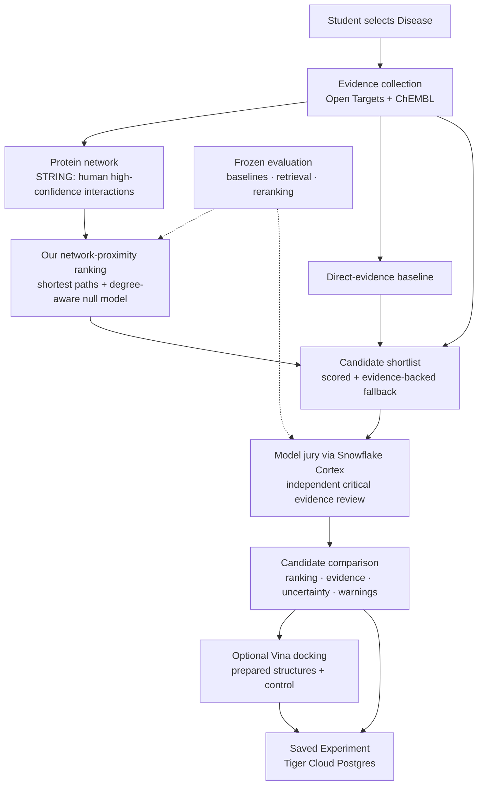

# OxHack '26 — Research-Driven Drug Repurposing

**Status:** Proposed team build plan · **Architecture:** Network proximity + independent evidence review  
**Audience:** OxHack development team · **Purpose:** One authoritative, practical plan to build and evaluate the system

> **Project statement:** OxHack is an educational research application that prioritises existing drugs as *hypotheses worth investigating* for a selected Disease. It uses a reproducible biological-network method to generate Candidates, checks the underlying scientific evidence with a Model jury, and makes its limitations visible. **It does not recommend treatment or predict clinical efficacy.**

---

## 1. Goal and research question

Build a student-friendly web application with a genuine computational research component, rather than an LLM interface that simply repeats an existing database ranking.

**Primary research question**

> Does network proximity between drug Targets and Disease-associated proteins improve the retrieval and prioritisation of established drug–Disease relationships compared with direct Target-evidence ranking?

**Secondary question**

> When the same Candidates are reviewed without seeing their initial ranking, does an evidence-grounded Model jury add useful critical analysis, and does its independent ordering improve ranking on a controlled test set?

**Success means:** the app works end-to-end; rankings and explanations are traceable to sources; the evaluation fairly compares the method with simple baselines; limitations and negative findings are reported accurately. A positive benchmark result is **not** guaranteed and is **not** required to claim the engineering work succeeded.

## 2. Product: what a student actually does

1. **Select a Disease.** Resolve the name to a stable biomedical identifier.
2. **Explore its biology.** Show the most relevant Targets, their evidence and their positions in the protein network.
3. **Discover Candidates.** Search a defined universe of previously approved drugs. Rank scorable Candidates using our network-proximity algorithm; use transparent evidence-based retrieval when the network has insufficient coverage.
4. **Read the evidence.** For each Candidate, show its Targets, mechanism of action, bioactivity evidence, sources, documented safety warnings and missing information.
5. **See the Model jury.** Several AI models independently inspect the same structured evidence, explain concerns and rank the shortlisted Candidates. They do **not** initially see the network ordering or score.
6. **Compare Candidates.** Compare Candidates *within this Experiment* on evidence, network result, jury assessment, warnings and available docking results.
7. **Explore an optional binding pose.** For supported Candidate–Target structure pairs, perform AutoDock Vina docking and display predicted poses in 3D, together with a real structural control.
8. **Revisit the Experiment.** Save its selected Disease, fixed jury configuration, data versions, ranking settings, Candidates, evidence and docking references. Archive and restore rather than deleting.

**UI vocabulary:** Disease, Target, Candidate, binding pose, Model jury, Guided mode, Known-answer check, Experiment, Candidate comparison, Archive. One Experiment has **one Disease and one Model jury configuration**. Model agreement means consistency, not probability of success.

## 3. Architecture and necessary data



### Data sources: minimal, purposeful

| Source | Essential role | What we **do not** infer |
|---|---|---|
| **Open Targets Platform** | Map Disease IDs; obtain Disease–Target association records and source-level evidence; provide clinical context where appropriate | Its association score is not a probability that a drug will treat a Disease |
| **ChEMBL** | Map approved small-molecule Candidates to measured or documented Targets and bioactivity; retrieve molecule structure identifiers | An assay measurement alone does not establish effective action in patients |
| **STRING** | Human protein-association network; start with documented high-confidence experimental interactions, with physical/functional edge type recorded | A network edge does not guarantee direct physical binding or therapeutically useful causality |
| **Regulator-backed approval records** (FDA, EMA, PMDA, DailyMed, read through Open Targets clinical reports) | Verify approval status and display safety documentation | Missing warnings do not mean a Candidate is safe |
| **PubChem** | 2D molecular drawings and structure identifiers, when available | A drawing does not establish activity |
| **RCSB PDB** | Experimental protein structures and co-crystal controls for docking | A structure and predicted binding pose do not prove treatment efficacy |

**Data policy:** pin exact release dates and download versions in a manifest; preserve stable identifiers, original source URLs, extraction dates and licence notices. Do not redistribute full datasets or use restricted data until their licences have been checked. Cache data to make demos reliable. No LLM-generated SQL or GraphQL in the retrieval pipeline.

### Identifiers

**Rule: one ID per kind of thing.** Every table, file, API response and join uses only the ID in the "Our ID" column. Other IDs are kept only as lookup columns for talking to a specific source, and are never used as keys. Names and symbols (`JAK1`, `baricitinib`) are display text only and never join anything.

| Thing | Our ID | Format | Example | Other IDs, used only for lookups |
|---|---|---|---|---|
| Disease | Open Targets disease ID, exactly as the API returns it | `^[A-Za-z]+_[0-9]+$` (underscore) | `MONDO_0009693` (plasma cell myeloma) | ChEMBL writes `MONDO:0009693`: replace `:` with `_` before joining |
| Protein (Target, and every network node) | Ensembl gene ID | `^ENSG[0-9]{11}$` | `ENSG00000162434` (JAK1) | UniProt `P23458` for ChEMBL and RCSB lookups; STRING `9606.ENSP00000499900` while building the network only |
| Drug (Candidate) | ChEMBL parent molecule ID | `^CHEMBL[0-9]+$` | `CHEMBL2105759` (baricitinib) | Salt and hydrate records, e.g. `CHEMBL1795071` (ruxolitinib phosphate), kept in `source_chembl_ids`; PubChem CID only for drawings |
| ChEMBL target (bioactivity only) | Not stored: converted to a protein ID straight away | `^CHEMBL[0-9]+$` | `CHEMBL2835` (JAK1, single protein) → `ENSG00000162434` | — |
| Protein structure (docking) | PDB ID + chain | `^[0-9][A-Z0-9]{3}_[A-Za-z0-9]+$` | `6WTO_A` (JAK2 with baricitinib) | Ligand component ID (`3JW`) stored with the structure |
| Experiment | UUID | Postgres `gen_random_uuid()` | `3f2c…` | — |
| Evidence item | `E` + number, unique within one Experiment | `^E[0-9]+$` | `E12` | Each item stores `source`, `source_id`, `url` and `release` |
| Candidate label in a jury packet | `C` + number, unique within one packet | `^C[0-9]+$` | `C3` | Mapped back to the ChEMBL ID after the vote; never shown to jurors |
| Data release | Source + version | `source-version` | `opentargets-26.09`, `chembl-37`, `string-12.5` | — |

### How each source maps to our IDs

| Source | What it gives us | How to convert |
|---|---|---|
| Open Targets | Disease IDs, Ensembl gene IDs, ChEMBL drug IDs | Already our IDs. For drugs, use `drug.parentMolecule.id` when present, otherwise `drug.id`. |
| ChEMBL | Molecule, target and disease IDs | Molecule → `molecule_hierarchy.parent_chembl_id`. Target → keep only `SINGLE PROTEIN` targets, take the UniProt accession, then map UniProt → Ensembl gene with Open Targets `target.proteinIds`. Disease → `:` becomes `_`. |
| STRING | Protein IDs like `9606.ENSP00000499900` | Drop the `9606.` prefix and look up the `ENSP` in Open Targets `target.proteinIds` (source `ensembl_PRO`). Checked: JAK1's list contains `ENSP00000499900`. If several STRING proteins map to one gene, merge their edges into one node. |
| RCSB PDB | Entries with UniProt accessions | UniProt → Ensembl gene, as above. A structure only belongs to the protein it actually contains: a JAK2 structure is never shown for JAK1. |
| PubChem | CIDs and 2D drawings | Look up by the ChEMBL InChIKey (`XUZMWHLSFXCVMG-UHFFFAOYSA-N` for baricitinib), never by name |

### Mapping rules

- **Old disease IDs.** IDs change between releases: `EFO_0001378` (multiple myeloma) now returns nothing, and `MONDO_0009693` lists it under `obsoleteTerms`. Always store the current ID, and resolve old ones through `obsoleteTerms`.
- **Salts.** Merge salts and hydrates into the parent molecule, but never merge two different parents. Open Targets wrongly parents deuruxolitinib phosphate to ruxolitinib, so keep a small override list for known bad links.
- **No guessing.** If a mapping is missing or ambiguous (one source ID to several of ours, or the other way round), mark the item `unmapped` with the reason, keep it visible, and count it in coverage. Never fall back to matching on names or symbols.
- **One release at a time.** Every ID is valid for its pinned data release. Record the release with every stored row.

## 4. The prediction method: network proximity

**Why this method:** A direct-target ranking mainly finds drugs acting on proteins already strongly associated with the Disease. A network method can also investigate drugs acting on proteins connected to those Disease Targets. It is established, explainable, reproducible, feasible on CPU, and does not depend on a third-party neural model's fixed disease coverage.

### 4.1 Build the graph once

1. Download a **human** STRING interaction dataset and select an explicitly documented edge subset and confidence threshold. Record if edges are physical interactions or functional associations.
2. Retain only proteins that can be mapped to the Target identifiers used by Open Targets and ChEMBL.
3. Store the graph as versioned edge lists and a sparse adjacency representation (SciPy). Score only on its **largest connected component**; retain proteins outside it in the mapping report as `not_in_network`, with the reason recorded.
4. Validate basic properties: node/edge counts, duplicate edges, self-loops, mapping rates and connected-component sizes.
5. **Precompute distances once.** Compute all-pairs shortest-path distances on the pinned largest connected component (unweighted, e.g. SciPy `csgraph.shortest_path` run in row chunks) and store them as a `uint8` matrix of about n² bytes (roughly 360 MB for 19,000 proteins). Reserve `255` for unreachable pairs; never average it or cast infinity directly to `uint8`. Check that finite distances fit in `0–254` before saving. Ranking a Disease, including the degree-matched random samples, then needs only lookups; nothing is recomputed per request.

### 4.2 Build the Candidate universe

1. Assemble a reusable list of **existing approved drugs**. Keep a drug only if Open Targets lists an indication at `APPROVAL` whose clinical reports include a regulator source: `FDA`, `EMA Human Drugs`, `PMDA` or `DailyMed` (checked on release 26.09; see `docs/build-reference.md` step A6). Stage fields alone are not enough: Open Targets lists navitoclax at `APPROVAL`, but it has never been approved.
2. Map each eligible drug to its supported human Targets using documented mechanism evidence; add ChEMBL bioactivity links only under a predeclared assay/target-quality rule.
3. Record Target type, evidence provenance, action type when known, and the number of supported Targets.
4. Keep Candidates even when they are not network-scorable, but mark that status. Do not assign missing Candidates a network score of zero.

### 4.3 Rank a Disease

1. Resolve the Disease to its identifier.
2. Select Disease Targets with one fixed rule: the **top 50 Targets by `evidence_only` association score**. These are Open Targets scores recomputed without trial-derived `clinical_precedence` and drug-naming `cancer_biomarkers` evidence (`docs/build-reference.md` step A3). Keep only Targets that map into the network, and show which were selected. In the pilot only, check sensitivity with the top 25 and top 100, then freeze the rule before the final test.
3. For each drug, calculate the average minimum shortest-path distance between its mapped Targets and the Disease Target set:

   \[
   d(C,D)=\frac{1}{|T_C|}\sum_{c\in T_C}\min_{t\in T_D}\operatorname{dist}(c,t)
   \]

   where `T_C` and `T_D` contain only the drug's Targets and Disease-associated Targets retained in the largest connected component. Report retained and excluded Target counts for both sets. Lower distances mean greater network proximity, **not greater clinical efficacy**.
4. Account for network hub bias: compare observed distance with distances from **degree-matched random Target sets** of equal size, using a deterministic random seed. Randomise both the drug Target set and Disease Target set. Draw replacement proteins from degree bins containing **at least 100 proteins**, grouping adjacent degrees and merging any undersized final bin into its neighbour, following the binning approach in [Guney et al. (2016)](https://doi.org/10.1038/ncomms10331). Sample distinct proteins within each random set. Report the observed distance and a null-model z-score; smaller z-scores indicate closer-than-expected proximity under this chosen null. Freeze the number of randomisations (e.g. 200 for the MVP) and test stability.
5. Return ranked Candidates, pathway/network connections explaining their proximity, coverage status and full calculation provenance. Paths are *network explanations*, not proven mechanisms.

**Important:** direct overlaps can dominate the score, so also calculate an evidence-only ranking and a count of directly shared Targets. Run an ablation excluding direct drug–Disease Target overlaps to test whether indirect network connections truly add anything.

**Scoring eligibility:** at least one Disease Target and at least one Candidate Target must map into the largest connected component. Otherwise return `not_scorable`, with no network score and an exact reason; keep the Candidate visible. If no Disease Targets remain, use the direct-evidence fallback in section 4.4. Never substitute zero for a missing score.

**Zero null spread:** if all random distances are identical, the z-score is undefined. Return `distance_only`, preserve the observed distance, set `degree_matched_z = null`, and flag `zero_null_variance`. Keep these Candidates after all Candidates with valid z-scores and report their count.

**Deterministic ordering:** sort scored Candidates by ascending z-score, then ascending observed distance, then ascending ChEMBL ID. Sort the following `distance_only` group by ascending observed distance, then ChEMBL ID. Keep `not_scorable` Candidates unranked in the network result and available to the evidence fallback. Measure tie frequency and zero-spread counts in the pilot rather than assuming they will be rare or common.

### 4.4 Transparent fallback

For a Disease with insufficient network coverage, return evidence-backed Candidates ranked by a deterministic **direct Target-evidence baseline**. Label the display `Evidence ranking — network unavailable`; do not imply a network prediction happened.

The shortlist should include the strongest **network-scored Candidates** while retaining a small number of strong **direct-evidence Candidates** that the network method would otherwise miss. Start with **10 network + 5 evidence**, deduplicate, and fill remaining places from the next eligible candidates to target 15 where available. This is an engineering policy to be evaluated—not a validated optimal split. Record why every Candidate was selected.

The UI highlights five Candidates and allows the rest to be expanded. A Candidate is never described as a recommended treatment.

## 5. Model jury: independent scientific review

**Purpose:** challenge the scientific plausibility of shortlist Candidates and make disagreement visible. The jury is *not* an extra graph model, a replacement for evidence, or proof that the prediction is correct.

**Implementation:** three distinct available Snowflake Cortex model families, pinned by model ID; one fixed jury configuration per Experiment. Verify model availability and cost in the actual account before freezing the configuration.

All jurors receive the **same source-grounded evidence items** and the same Candidate set, with independently shuffled ordering. Initially hide network score, network rank, the shortlist-selection reason and any existing overall Candidate rank. Disclose that the listed Candidates are being investigated; avoid asking the models to endorse them.

For each Candidate, require:

- Evidence-grounded scientific rationale and a separate **critical objection**;
- Whether drug action and Disease biology support the *direction* of the hypothesis—or `unknown`;
- Supporting evidence IDs, contradictory evidence IDs, and explicit missing evidence;
- Documented safety warnings, without treating missing data as safety;
- A rank within the fixed jury review set and a decision: `investigate`, `watch`, or `deprioritise`.

**Validation:** JSON schema, unique ranks, IDs that exist in the packet, exact numeric checks, and a bounded retry. Record invalid outputs and juror failures; do not fabricate a vote. Call a machine-checked statement **structurally supported**, not scientifically proven; manually audit a sample of biological reasoning claims.

**Display:** network rank, direct-evidence rank and jury consensus **side by side**. Show per-juror ranks, contested Candidates, citations and disagreement metrics. Do not average unrelated raw scores into an arbitrary treatment-success percentage. Consensus can use Borda ranking; agreement (e.g. Kendall's W) measures model consistency, not probability.

## 6. Evaluation: the centre of the scientific work

**Principle:** every algorithm must beat or clarify a simpler alternative. Freeze evaluation inputs, candidate eligibility, seeds, source versions, model versions and metrics *before* looking at final results.

### 6.1 Experiment A — Candidate retrieval

**Question:** Starting from a broad fixed universe of eligible drugs, does network proximity recover documented drug–Disease relationships better than simple methods?

Rank **the same eligible universe** using:

1. Random ranking (sanity baseline).
2. Drug/network popularity baseline.
3. Direct shared-Target count.
4. Best direct disease–Target evidence among a drug's Targets.
5. **Network proximity** with degree-matched null model.

**Metrics:** Recall@5, @10, @20; mean reciprocal rank (MRR); number and proportion of eligible pairs scorable by each method. Report the disease count, eligible-universe size and bootstrap confidence intervals over Diseases. Use a paired comparison of methods on the same Diseases.

### 6.2 Experiment B — Jury reranking

**Question:** On **exactly the same frozen panel** of 15 Candidates per Disease, does the Model jury improve rank quality or expose unsupported assumptions?

- Build each panel as **one true drug plus 14 popularity-matched approved decoys** that have no record for that Disease, drawn with a fixed seed. Keep panels identical across all jury configurations and direct/network baselines. Chance levels for 15 Candidates: Hits@5 = 33% (5 ÷ 15) and MRR ≈ 0.22.
- Compare direct-evidence ordering, network ordering, independent jury consensus, and an explicitly declared combination *only if one is later designed and validated*.
- Report Hits@5 and MRR, citation-ID validity, structural claim checks, and an independently selected manual audit of scientific claims.
- Explicitly measure **selection recall** separately: the jury cannot recover a Candidate absent from the panel.

### 6.3 Leakage and interpretation

The strongest evaluation is a historical split: use the same pre-cutoff snapshots for **every** predictive input, then test drug–Disease relationships first recorded later. A newly curated relationship is not necessarily a new approval or a genuinely novel discovery.

If valid time-aligned sources cannot be obtained during the hackathon, use a clearly labelled **retrospective known-relationship recovery test** instead. Exclude direct indication/trial labels from ranking features and jury packets, but disclose any residual indirect leakage. **Do not call that prospective or clinical validation.**

Other essential safeguards:

- Unrecorded drug–Disease links are **unlabelled**, not proven ineffective; document decoy selection.
- Sample a range of Diseases, not only COVID-19 and multiple myeloma.
- Match or control for popularity, degree and number of drug Targets where possible.
- Use a small pilot, then freeze a final set; never tune parameters on the final test results.
- Run an ablation with protein interactions removed and one with direct shared-Target matches removed.
- Report negative results and unsupported cases alongside successes.

**Known-answer check:** selecting COVID-19 should retrieve baricitinib through the normal retrieval process where source data supports it. Do not hardcode or inject the Candidate; this checks pipeline behaviour, not treatment-validation accuracy.

## 7. Docking: a separate structural investigation

Docking is **not part of Candidate ranking**.

- Use **AutoDock Vina on CPU**, with RDKit/Meeko for ligand/receptor preparation as appropriate.
- Support a small, verified set of **prepared human Target structures** from RCSB PDB. Map each structure to its actual protein Target; never show a JAK2 structure as JAK1.
- On request, dock one supported Candidate–Target pair, save poses, scores, software versions, protein ID and parameters, then show an interactive 3D viewer (3Dmol.js).
- Perform at least one **redocking control** against a crystal ligand with a known pose and report the measured RMSD, not a pre-filled pass.
- The queue can run as a separate CPU worker on Vultr; cache verified results for a reliable demonstration.
- Explain clearly that a binding pose is a geometric hypothesis, and that a Vina score is **not a measured binding affinity, probability of binding, or clinical effect**.

Unsupported structures, failed docking jobs and unscorable Candidates remain visible with informative reasons.

## 8. Technology and infrastructure

| Layer | Decision | Reason |
|---|---|---|
| Backend | **Python 3.11 + FastAPI** | Scientific libraries and straightforward API |
| Network method | **SciPy sparse arrays**, plus NetworkX for development/inspection if useful | CPU-based, deterministic, inspectable |
| Scientific data | Versioned Parquet/CSV and cached API responses | Reproducible and economical |
| Jury | **Snowflake Cortex** | Distinct evidence-review models and sponsor integration |
| Storage | **Tiger Cloud PostgreSQL** | Experiments, Candidates, provenance, jury votes, docking metadata and archive/restore |
| Frontend | **React + TypeScript + Vite** | Guided interface and comparison |
| 3D | **3Dmol.js** | Browser-based pose viewing |
| Docking | **AutoDock Vina CPU worker** | Accessible deployment without GPU dependency |
| Hosting | **Vultr CPU VM**, where available | One deployment for API, worker and built frontend |

A GPU is **not a requirement**. TxGNN and KG-Bench RGCN are useful research references and potential later comparisons, **not production dependencies**.

**Secrets:** environment variables in uncommitted `.env`; maintain `.env.example`. Never commit credentials, licensed bulk datasets, or large binary model files. Pin versions, record provider-region and availability checks, and maintain a local/cache fallback for external API outages.

## 9. Shared application contracts — agree before parallel work

### 9.1 Minimal API

| Endpoint | Purpose |
|---|---|
| `GET /api/diseases/search?q=` | Search mapped Diseases |
| `POST /api/experiments` `{disease_id}` | Create one Experiment and compute/cache Candidates |
| `GET /api/experiments/{id}` | Get Disease, Targets, Candidates, scores, evidence, jury and docking references |
| `GET /api/experiments` | History, with archived filter |
| `POST /api/experiments/{id}/jury` | Ask the fixed Model jury to review the saved shortlist |
| `POST /api/experiments/{id}/archive` / `restore` | Reversible history management |
| `GET /api/structures` | Supported Target protein structures and controls |
| `POST /api/dock` | Queue one Candidate–Target pose computation |
| `GET /api/dock/{id}` | Status and results, including failures |
| `GET /api/evaluation` | Frozen metrics and provenance |

### 9.2 Candidate output fixture

```json
{
  "candidate_id": "CHEMBL3545376",
  "name": "ERDAFITINIB",
  "status": "scored",
  "selected_by": ["network", "evidence"],
  "network": {
    "rank": 3,
    "mean_distance": 1.8,
    "degree_matched_z": -1.4,
    "graph_version": "string-12.5"
  },
  "direct_evidence_rank": 7,
  "targets": [
    {"id": "ENSG00000068078", "name": "FGFR3", "mechanism": "INHIBITOR"}
  ],
  "evidence": [
    {"id": "E1", "source": "open_targets", "release": "opentargets-26.09", "url": "https://platform.opentargets.org/evidence/ENSG00000068078/MONDO_0009693", "kind": "target_association"}
  ],
  "warnings": [],
  "safety_status": "unknown",
  "dockable": false
}
```

**The IDs are real and follow section 3; every score and rank is fictional, not a study result.** For an unscorable Candidate: `status = "not_scorable"`, `network = null`, and an explicit `unscorable_reason`. For zero null spread: `status = "distance_only"`, retain `network.mean_distance` and `network.rank` under section 4.3's ordering, set `network.degree_matched_z = null`, and include `network.warning = "zero_null_variance"`. Jury results are stored as a separate object, so reviewers cannot unknowingly inherit the network score.

### 9.3 Minimum persistent tables

- `experiments`: ID, Disease, data-release manifest, jury model IDs, ranking settings, timestamps, archived flag.
- `candidates`: Experiment ID, stable Candidate ID, complete evidence payload, network score/status, direct evidence score, shortlist provenance.
- `jury_votes`: Experiment ID, model ID, Candidate ID, rank, decision, evidence IDs, rationale, validation status, latency.
- `dock_jobs`: Experiment ID, Candidate ID, **Target/protein ID**, PDB ID, settings, status, pose-file references and measured control results.
- `evaluation_results`: frozen manifest hash, method, dataset versions, metrics, coverage, confidence intervals.
- `evidence_cache`: versioned source responses and retrieval timestamps.

Keep large graph arrays, source Parquet and pose files in files/object storage; keep their checksums and paths in PostgreSQL. Only use TimescaleDB time-series features if there is genuine measured operational data worth displaying (e.g. jury latency or docking durations).

## 10. Team ownership

Three workstreams, one owner each. Each interface has one owner.

| Workstream | Owner delivers | First integration test |
|---|---|---|
| **A — Biomedical data + jury** (Jessica) | Open Targets, ChEMBL and STRING ingestion; regulator-backed approved-drug list; stable IDs; the Disease Target rule; evidence packets and fixtures. Then the Cortex jury client, reviewer schema, claim validation and agreement data. | One Disease → mapped Targets and approved Candidates with real citations; three jurors review one saved 15-Candidate packet |
| **B — Prediction + evaluation** (Zaid) | Graph construction, the precomputed distance matrix, the network-proximity algorithm, baselines, coverage report, frozen retrieval and re-ranking evaluation | The same input produces reproducible ranked Candidates and a baseline comparison |
| **C — Product + docking/infrastructure** (Abudi) | FastAPI integration, Tiger schema, React views, Vina worker and 3D viewer, Vultr deployment | A saved Experiment shows Candidates and one verifiable docking result |

**Parallelism:** A and B agree identifiers and fixtures first. B then builds the graph and distance matrix while A builds the evidence pipeline. A develops the jury against frozen fixture packets. C scaffolds the frontend, history and docking preparation without waiting for model results. Keep docking a bounded, cached demonstration.

## 11. Milestones and acceptance tests

| Milestone | Deliverable | Done when |
|---|---|---|
| **M0 — Contract and feasibility** | Source availability, identifier map, network download, sponsor access | Team approves contracts; chosen Disease and at least one drug map across datasets; no unresolved mandatory GPU dependency |
| **M1 — Evidence vertical slice** | Real data from Disease through Candidate | Two demo Diseases work, with approval provenance, Targets and evidence IDs; missing data handled safely |
| **M2 — Network ranking** | One working Python scorer | Graph loaded; ranked output reproducible; reasons for unscorable drugs present; baselines implemented |
| **M3 — Research evaluation** | Frozen pilot and metrics | Ten-Disease pilot completed; retrieval compared on same candidate universe; leakage limitations recorded |
| **M4 — Jury** | Independent source-grounded reviews | Three jurors return validated ranks for one Experiment; contradictions and missing evidence shown; failures handled |
| **M5 — Product and docking** | End-to-end guided interface | Candidate comparison, saved history, archive/restore, one actual prepared-pair docking result and measured control |
| **M6 — Final evidence + demonstration** | Evaluation report and deployed application | Frozen final results and provenance accessible; two rehearsed end-to-end demonstrations; README and disclaimer complete |

**First working demonstration:** Disease → real Targets and approved Candidates → network ranking + direct baseline → one evidence-backed Candidate page. Build this before creating visual polish or additional algorithms.

## 12. Fallbacks and scope control

| Failure | Response |
|---|---|
| Low STRING or identifier coverage | Keep direct evidence ranking; show exact missing coverage; report network results only where scorable |
| Network proximity not better than baseline | Publish the result and retain direct evidence as default; still show graph insights as experimental analysis where appropriate |
| Historical data releases are inconsistent | Label the study retrospective recovery, **not** a prospective test; do not claim out-of-time generalisation |
| Jury endpoint inaccessible | Show evidence and network results without a jury; record that the review is unavailable rather than substituting invented judgments |
| Docking worker unavailable | Show cached, previously measured demonstrations for supported pairs; explain that live docking is unavailable |
| Time runs short | Prioritise evidence correctness → scorer + baseline → evaluation → jury → docking → UI polish. Keep one polished working vertical slice |

**Out of scope:** training RGCN or TxGNN, generating novel molecules, predicting clinical treatment success, automatically changing the Model jury configuration, arbitrary blended success percentages, cross-Experiment Candidate comparison, additional docking engines, GPU infrastructure solely for prestige, and general-purpose biomedical chat.

## 13. How we present findings to judges

Show the **scientific hypothesis**, not just a list of technologies:

1. The student chooses a Disease; show the disease-associated Targets and their sources.
2. Compare the **direct-evidence ranking** with the **network-proximity ranking**. Explain one network path, including its limitations.
3. Let the jury challenge an interesting Candidate. Show a real disagreement or missing-evidence finding, not manufactured agreement.
4. Show the retrospective evaluation with baselines, number of Diseases, mapping coverage, confidence intervals and a frozen manifest hash.
5. Show one supported binding pose and its real redocking control, explaining that docking is not efficacy evidence.
6. Demonstrate saved Experiments, comparison within an Experiment, and archive/restore.

**Allowed claim:** “We implemented and evaluated a reproducible biomedical network-proximity method against transparent baselines, and used a separately blinded AI jury to examine the scientific support for its Candidates.”

**Not allowed without additional evidence:** “We discovered a new treatment,” “our network score is a success probability,” “jury agreement validates efficacy,” or “docking confirms binding or clinical benefit.”

**Required disclaimer:** “Educational research tool. Candidate rankings, Model jury assessments and binding poses are hypotheses based on public records and computational methods. They may be wrong or incomplete. They are not medical advice.”

## 14. Reading and source references

These are starting points for the team to inspect and pin, **not substitutes for validating API versions, licences and data schemas**.

- Open Targets Platform: <https://platform.opentargets.org/> · API: <https://api.platform.opentargets.org/api/v4/graphql>
- ChEMBL: <https://www.ebi.ac.uk/chembl/> · API: <https://www.ebi.ac.uk/chembl/api/data/>
- STRING: <https://string-db.org/> · downloads: <https://string-db.org/cgi/download>
- FDA Drugs@FDA: <https://www.accessdata.fda.gov/scripts/cder/daf/> · DailyMed: <https://dailymed.nlm.nih.gov/dailymed/>
- RCSB PDB: <https://www.rcsb.org/> · PubChem: <https://pubchem.ncbi.nlm.nih.gov/>
- Network-proximity approach: Guney et al., *Network-based in silico drug efficacy screening*, Nature Communications (2016): <https://doi.org/10.1038/ncomms10331>
- KG-Bench (benchmark methodology and caveats, **not a required model**): <https://github.com/cmbi/Benchmark_GNN_OpenTargets>
- AutoDock Vina: <https://vina.scripps.edu/> · 3Dmol.js: <https://3dmol.csb.pitt.edu/>

---

## Decision in one sentence

**Build one defensible network-proximity prediction method, test it against direct-evidence baselines, use the Model jury for independent evidence criticism, and keep docking as an optional structural exploration—not as proof that a drug will work.**
