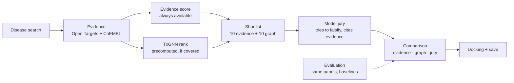

# Version 3: graph predictions, tested against evidence

Version 3 keeps Zaid's Version 2 architecture: a graph model makes predictions, Open Targets and ChEMBL supply the evidence, and the Model jury tries to falsify the predictions. It fills the gaps that would otherwise sink the plan in a technical review.

Every graph score, jury verdict and docking pose is shown with its source. None of them is a probability that a drug works.

**Positioning:** an evidence-grounded drug-repurposing research platform. It tests whether graph-learning predictions hold up against database evidence and simple baselines, and it traces every claim to a source record.

## 1. What changed from Version 2

| Topic | Version 2 | Version 3 | Why |
|---|---|---|---|
| Graph model | "Investigate TxGNN or another inductive model" | TxGNN is the graph model, if it passes a go/no-go gate (section 4). The KG-Bench RGCN is dropped. | TxGNN covers common diseases; the KG-Bench graph does not (section 3) |
| Go/no-go test | Weights load; count coverage | Also reproduce the paper's own evaluation, then measure Hits@10, Hits@20 and MRR on an independent set within the drugs OxHack supports | Users report the public TxGNN weights score far below the paper (section 3) |
| How TxGNN runs | Not specified | Run once offline on a GPU machine. Store rankings for the demo and backtest diseases. The live app reads the stored table. | The old stack (Python 3.8, DGL 0.5.2) never runs inside the live app |
| Shortlist | Graph predictions | Up to 10 from TxGNN plus up to 10 from the evidence score, deduplicated and tagged with why each drug is there | Neither signal hides the other. If TxGNN has no coverage, all 20 come from evidence. |
| Default sort | Not specified | Evidence score, until the evaluation shows another order does better | Genetics-backed evidence is the only signal with outcome data (about 2.6× success) |
| Jury questions | Includes "achievable drug exposure" | Only questions the fetched evidence can answer; otherwise the jury must answer "unknown" | Our sources have no dosing or exposure data, so the jury would have to guess |
| Hallucination control | "Verify citations" | Claim-level checks in code, plus two published rates | Valid citations are not enough: 50–90% of LLM medical answers are not fully supported by their sources |
| "Can the graph generalise?" test | Withhold treatments during training | Test on new indications approved **after** TxGNN's data snapshot | Withholding needs retraining. A post-snapshot test works with the pretrained weights. |
| Ablation | Five configurations, mixed together | Two separate experiments: **retrieval** (does the true drug make the shortlist?) and **re-ranking** (how well is a fixed 20-drug panel ordered?) | A fresh shortlist and a fixed panel test different things, so their numbers can't be compared |
| Newer drugs | Not mentioned | Marked `not_in_model`; they still reach the shortlist through the evidence lane | TxGNN's graph lacks drugs such as adagrasib and sotorasib |
| Fallback | "Smaller graph model or network propagation" | Evidence score, plus an optional logistic regression on evidence features | Cheap to train and covers every disease and drug in Open Targets |

## 2. Architecture

| Layer | What it does | Source | Rule |
|---|---|---|---|
| Scientific data | Disease → targets → approved drugs, with mechanisms, potency, warnings and trials | Open Targets 26.09, ChEMBL 37 | Facts come only from here. Every item gets an evidence ID. |
| Evidence score | Ranks drugs by their strongest non-trial link to the disease | Computed from the data layer | Deterministic, with no AI involved |
| Graph prediction | Ranks drugs by learned graph patterns | TxGNN, precomputed offline | Shown as "graph-model guess", never as evidence |
| Shortlist | Up to 10 graph + up to 10 evidence, deduplicated | Both lanes | Each drug is tagged `graph`, `evidence` or `both` |
| Model jury | Tries to falsify each candidate using only the packet | 4 Snowflake Cortex models | Hidden graph scores; cites evidence IDs; claims checked in code |
| Comparison | Evidence score, graph rank and jury verdict side by side | All of the above | No blended score |
| Docking | Predicted binding poses for prepared structures | AutoDock Vina | Illustration only. Docking scores never rank drugs. |
| Evaluation | Baselines, post-snapshot test and ablations | Frozen manifests | Decides which order becomes the default |

## 3. Facts the plan stands on

### Coverage

Checked on 24 Oct 2026 against each graph's own node files and the live API.

| Disease or drug | KG-Bench RGCN graph | TxGNN graph | Open Targets 26.09 (live) |
|---|---|---|---|
| Multiple myeloma | Absent (only "asymptomatic myeloma") | Present ("plasma cell myeloma", MONDO 9693) | Present (`MONDO_0009693`) |
| Type 2 diabetes | Absent (only "type 2 diabetes nephropathy") | Present (MONDO 5148) | Not checked |
| COVID-19 | Present | Not checked | Present (`MONDO_0100096`) |
| Adagrasib, sotorasib | Absent | Absent | Present |
| Baricitinib, venetoclax | Present | Present | Present |
| Diseases / drugs in total | 9,339 / 1,966 | 17,080 / 7,957 | Live |

### Risks

| Risk | Fact | Source |
|---|---|---|
| Public TxGNN weights may underperform | Issue #29 reports mean AUPRC 0.032 against 0.437 published (5 areas × 5 seeds). Issue #25 reports 0.1–0.2 lower. No author reply. | github.com/mims-harvard/TxGNN/issues |
| Old software | Python 3.8 and DGL 0.5.2, with CUDA in the examples. Downloads are a 1.5 GB example checkpoint and a graph of about 1 GB. | TxGNN README |
| No ready-made rankings | No per-disease prediction table is published. txgnn.org returned HTTP 503 on 24 Oct 2026. | Nat Med paper; live check |
| Data licence | Drug nodes are DrugBank IDs; DrugBank academic data is CC BY-NC 4.0. Treat outputs as non-commercial and credit DrugBank and PrimeKG. | PrimeKG README; DrugBank |
| Simple baselines can match graph models | On the KG-Bench graph, counting shared targets separates known from random pairs at AUC 0.848 with no model, against 0.84–0.91 for the GNNs (training pairs). | Team check of KG-Bench `processed_data` |
| LLM citations | 50–90% of LLM medical answers are not fully supported by their cited sources. | Wu et al., *Nat Commun* 2025 |
| LLM juries | Models agree 60% of the time when both are wrong; 9 judges carry about 2 independent votes. | Kim et al., ICML 2025; Kohli, arXiv 2605.29800 |
| Strongest known signal | Drug mechanisms with genetic support have about 2.6× the probability of clinical success. | Minikel et al., *Nature* 2024 |

## 4. TxGNN go/no-go gate (do this first)

| # | Check | Pass when | If it fails |
|---|---|---|---|
| G1 | Environment | The TxGNN container or a Python 3.8 + DGL 0.5.2 environment loads the checkpoint on a Linux machine (GPU, or CPU build if the GPU build fails) | Stop: use the evidence score only (section 9) |
| G2 | Disease coverage | Demo diseases map to TxGNN nodes by MONDO number (multiple myeloma → 9693). Open Targets EFO-only IDs map through `disease.dbXRefs`. | Show `not_in_model` for unmapped diseases; the evidence lane fills the shortlist |
| G3 | Drug coverage | DrugBank IDs map to ChEMBL through Open Targets `drug.crossReferences` (source `drugbank`), for example baricitinib `DB11817` → `CHEMBL2105759` | Unmapped drugs are `not_in_model`, never score 0 |
| G4a | Reproduce the original evaluation | Run TxGNN's own evaluation (`reproduce/` in its repo) with the shipped checkpoint on one of the paper's disease-area splits. The AUPRC is within 20% of the paper's value for that split. | No-go as a ranker. Issue #29 reports 0.032 against 0.437 published, so a large gap is a real risk. |
| G4b | Independent validation in OxHack's drug universe | Positives: 20 regulator-backed indications added after TxGNN's snapshot (the section 6 source), for drugs in TxGNN's graph. Rank each disease's drugs within the **OxHack universe** (regulator-approved drugs that map to ChEMBL), keeping only the drugs that also map to a TxGNN DrugBank node. Report the universe size, Hits@10, Hits@20 and MRR with intervals and chance (K ÷ universe size). Pass when Hits@20 and MRR at least match the better of the popularity and shared-target baselines on the same set. | No-go as a ranker. TxGNN may still appear as a labelled column, with the failed result shown. |
| G5 | Reproducibility | The same inputs give the same scores after a restart | Fix the seed and model version, or no-go |
| G6 | Throughput | Rankings for all demo and backtest diseases are computed and stored | Cut the backtest to the diseases that finished |

**Stored output:** `graph_predictions(disease_id, drug_chembl_id, raw_score, rank, status, model_version, snapshot_date)`. The live app only reads this table.

## 5. Model jury as falsifier

The jury never sees TxGNN scores or ranks in its first pass. Every question must be answerable from the fetched packet.

| Question | Evidence the jury may cite | When the packet has none |
|---|---|---|
| Is there independent evidence linking the drug's targets to the disease? | Open Targets genetic, somatic, pathway and animal-model evidence (not trial evidence) | "No independent link found" |
| Does the drug act on the target in a useful direction? | Mechanism `actionType` (INHIBITOR, AGONIST…) plus any direction-of-effect data in the packet | "Direction unknown" |
| Is the drug potent at the target? | ChEMBL median pChEMBL and number of assays | "No potency data" |
| Are there contradictions or safety concerns? | `drugWarnings`, adverse-event signals (`logLR` above `criticalValue`), trials with `trialWhyStopped` | "No contradictions found in our sources", never "safe" |
| Is the dose achievable in patients? | Not in our sources | Always "Not assessed: no exposure data" |
| What evidence is missing? | The packet itself | List the missing evidence types |

### Checks in code

| Check | How | Shown to users as |
|---|---|---|
| Citation validity | Every cited ID exists in the packet | Citation-valid rate |
| Claim support | Each claim is structured as `{claim_type, drug_id, target_id, disease_id, evidence_ids, numbers}`. The cited record must contain those IDs, and any quoted number must match it. | Supported-claim rate |
| Failure handling | Re-ask once; on a second failure, drop that juror for the run | A juror marked "dropped" with the reason |
| Agreement | Kendall's W, rank spread, contested flag | "Where the models disagree", never "4/4 agree" |

## 6. Evaluation: Version 2's four questions, made feasible

| Research question | Version 3 experiment | Leakage control |
|---|---|---|
| Can the graph model generalise? | **Post-snapshot test** in both experiments (section 7). Positives are indications first approved by a regulator after TxGNN's data snapshot (graph files dated 7 Jun 2023), for drugs already in TxGNN's graph. | TxGNN never saw these approvals. The evidence score uses strict mode, and its newer data is disclosed. |
| Does it beat simpler methods? | Random, popularity, shared-target count and evidence score run in both experiments | Identical universe (retrieval) and identical panels (re-ranking) for every method |
| Does the jury add value? | Re-ranking experiment only: the jury orders the same fixed panels blind, compared with graph-only and evidence-only. The jury never retrieves. | Drug names hidden; memorisation caveat reported |
| Can we trust the explanations? | Citation-valid and supported-claim rates, plus a manual audit of 50 random claims | Audit sample drawn before reading the results |

### Rules

| Rule | Detail |
|---|---|
| Finding positives | New regulator-backed indications in Open Targets 26.09 that are absent from the 23.06 release's indication data. Check the 23.06 files are still downloadable. If not, use dated FDA or EMA approval reports where the record has a date. |
| Metrics | Retrieval: Recall@10 and Recall@20 over the whole OxHack universe; chance is K ÷ universe size. Re-ranking: Hits@1, Hits@5, Hits@10 and MRR on fixed 20-drug panels; chance is 5%, 25% and 50%, and about 0.18 for MRR. All with 95% bootstrap intervals over diseases. |
| Never mix | Retrieval and re-ranking numbers answer different questions. Report them in separate tables. |
| Sample | 30–50 diseases, one positive each. Pilot 10 first. |
| Negatives | Decoys have no record for the disease at any stage. They count as "unlabelled", not "proven ineffective". |
| Pre-registration | Freeze pairs, decoys, seeds, prompts and model versions, and store a SHA-256 before running |
| Coverage | `not_in_model` cases stay in the denominators. Report covered-only and all-case results side by side. |
| Default sort | The evidence score stays default unless TxGNN or TxGNN + jury beats it in Experiment 2 on the pre-registered metric, with non-overlapping intervals |

## 7. Ablation: two experiments

### Experiment 1: retrieval (does the true drug make the shortlist?)

Every method ranks the same set: all drugs in the OxHack universe (regulator-approved drugs that map to ChEMBL). The question is whether the true drug lands in the top K.

| Method | Metric | Model calls |
|---|---|---|
| Popularity, shared-target count | Recall@10, Recall@20 | None |
| Evidence score | Recall@10, Recall@20 | None |
| TxGNN | Recall@10, Recall@20, plus coverage. Drugs it can't score count as misses. | None (precomputed) |
| Combined shortlist (10 evidence + 10 graph) | Recall within the shortlist of up to 20 | None |

### Experiment 2: re-ranking (how well is a fixed panel ordered?)

Every method orders the same panel: the true drug plus 19 popularity-matched approved decoys.

| Method | Metric | Model calls |
|---|---|---|
| Random, popularity, shared-target count | Hits@1, Hits@5, Hits@10, MRR | None |
| Evidence score | Same | None |
| TxGNN | Same. Drugs it can't score go last and are flagged. | None (precomputed) |
| Jury alone (blind to all scores) | Same | 1 per disease per juror |
| TxGNN + jury | Same, using the average of the TxGNN rank and the jury consensus rank | None extra (reuses the jury calls) |

### Optional: end-to-end

Experiment 1's combined shortlist, then ordered by the jury. Metric: the share of diseases where the true drug ends in the jury's top 5, with retrieval misses counted as failures. Report this on its own, never beside Experiment 2's numbers.

**Jury calls:** 40 diseases × 4 jurors for Experiment 2 (160), plus 160 more if the end-to-end run is done.

**Reporting rule:** if the jury makes rankings worse, or TxGNN does not beat the shared-target count, report it as a finding. Do not hide it behind a consensus score.

## 8. Work split: three independent streams

People are assigned later. Each stream starts straight away using the sample files in `fixtures/`, then swaps in the real output at integration. Nobody waits for anyone.

### Shared contracts

Don't change these without telling the other two streams.

| Contract | Made by | Used by | Sample file |
|---|---|---|---|
| Candidate list for a disease | A | B, C | `fixtures/candidates.json` |
| Evidence packet for the jury | A | B | `fixtures/evidence_packet.json` |
| Stored graph predictions | B | A, C | `fixtures/graph_predictions.json` |
| Jury result | B | A, C | `fixtures/jury_result.json` |

### A: data and evaluation

| Step | Done when |
|---|---|
| Fetch Open Targets and ChEMBL evidence; compute the evidence score in three modes (`plan.md` steps A1–A11) | One disease returns sourced candidates in all three modes |
| Write `build_candidates(disease_id)` and `build_packet(candidates, mode)` with output in the sample-file shapes | Output matches the shape of the sample files |
| Build the shortlist: top 10 by evidence plus top 10 from graph predictions (sample file until B's table exists), tagged | Unique drugs, each tagged `graph`, `evidence` or `both` |
| Build the retrieval set and the fixed 20-drug panels, plus the metrics script (sections 6–7); run the no-AI rows of both experiments | Baseline rows of both experiments filled in, with intervals |

### B: models

| Step | Done when |
|---|---|
| Run the TxGNN gate G1–G6 on a GPU machine (section 4) | Pass or fail recorded for each check |
| If it passes, store predictions for the demo and backtest diseases in the sample-file format | Real rows replace the sample file |
| Set up Snowflake Cortex and write `review(packet)` with the falsifier prompt and checks (section 5), tested on the sample packet | A valid jury result with citation-valid and supported-claim rates |

### C: product

| Step | Done when |
|---|---|
| FastAPI app and Tiger schema (`plan.md` 6.3, plus `graph_predictions` and the shortlist tag), with history and archive | Experiments save and reload |
| Comparison screen built on the sample files: evidence score, graph rank, jury verdict, leak flags, safety, disagreement | The screen runs on sample data |
| Docking: prepare two or three structures, run Vina once, cache the poses, 3Dmol viewer with the redocking control | Cached poses show in the viewer |
| README and Devpost draft | Draft saved |

### Integration (the only hand-off)

| Swap | Who |
|---|---|
| Sample candidates and packet → A's functions | C calls A |
| Sample graph predictions → B's stored rows | A and C read B's rows |
| Sample jury result → B's `review(packet)` | C calls B; A runs the jury rows of the backtest |

### Cuts for a team of three

| Cut | Instead |
|---|---|
| Live docking queue | Pre-run Vina for two or three prepared pairs and show the cached poses. Add live docking only after the core journey works. |
| Evidence-feature fallback model | Build it only if TxGNN fails the gate and the core journey already works |
| End-to-end run (section 7) | Optional. Experiments 1 and 2 come first. |

Build steps, API contracts, database schema and docking details stay as in `plan.md`. Add the `graph_predictions` table from section 4 and the `graph` / `evidence` / `both` shortlist tag.

## 9. Fallbacks

| If | Then |
|---|---|
| TxGNN fails G1 (will not run) | Evidence score plus jury. Optionally train the evidence-feature model below. |
| TxGNN fails G4a or G4b (poor quality) | Same as above. Show TxGNN's failed gate result in the evaluation page as a finding. |
| Evidence-feature model (optional) | Logistic regression per drug–disease pair. Features: the best association by datatype across the drug's targets (genetic, somatic, pathway, animal model, expression), potency, shared-target count and popularity. Labels: regulator-backed approvals. Exclude trial and literature evidence, which encode the label. Split by disease so test diseases are unseen. Trains on CPU and covers every Open Targets disease and drug. |
| Snowflake AI unavailable | Point the same client at another LLM API the team can use, and drop the Snowflake prize entry |
| Live docking unstable | Serve cached poses for prepared pairs |

## 10. Claims

| Claim | Allowed? | Condition |
|---|---|---|
| "Every fact links to its source record" | Yes | Citation-valid and supported-claim rates are shown |
| "TxGNN predicted these candidates" | Yes | Labelled "graph-model guess", with model version and snapshot date |
| "The graph model generalises to new approvals" | Only with numbers | Post-snapshot test results with intervals and baselines |
| "The jury improves rankings" | Only if measured | The ablation shows it, with intervals |
| "4/4 models agree, so it's likely" | No | LLM errors correlate; agreement is not confidence |
| "This drug is safe" | No | Missing warnings mean "unknown" |
| "Docking shows the drug binds" | No | A pose is a geometric hypothesis, shown with a redocking control |
| "We discovered a treatment" | No | Candidates are research hypotheses |

## Sources

- Huang et al., "A foundation model for clinician-centered drug repurposing", *Nature Medicine* 2024: https://www.nature.com/articles/s41591-024-03233-x
- TxGNN code and issues (#25, #29): https://github.com/mims-harvard/TxGNN
- TxGNN data, Harvard Dataverse doi:10.7910/DVN/CNQV69; PrimeKG doi:10.7910/DVN/IXA7BM
- KG-Bench, *Bioinformatics* 2026: https://doi.org/10.1093/bioinformatics/btag159 and https://github.com/cmbi/Benchmark_GNN_OpenTargets
- Minikel et al., *Nature* 2024 (genetic support): https://pmc.ncbi.nlm.nih.gov/articles/PMC11096124/
- Wu et al., *Nature Communications* 2025 (SourceCheckup): https://pmc.ncbi.nlm.nih.gov/articles/PMC12003634/
- Kim et al., "Correlated Errors in Large Language Models", ICML 2025: https://arxiv.org/abs/2506.07962
- Kohli, "Nine Judges, Two Effective Votes", 2026: https://arxiv.org/abs/2605.29800
- PoseBusters, *Chemical Science* 2024: https://pmc.ncbi.nlm.nih.gov/articles/PMC10901501/
